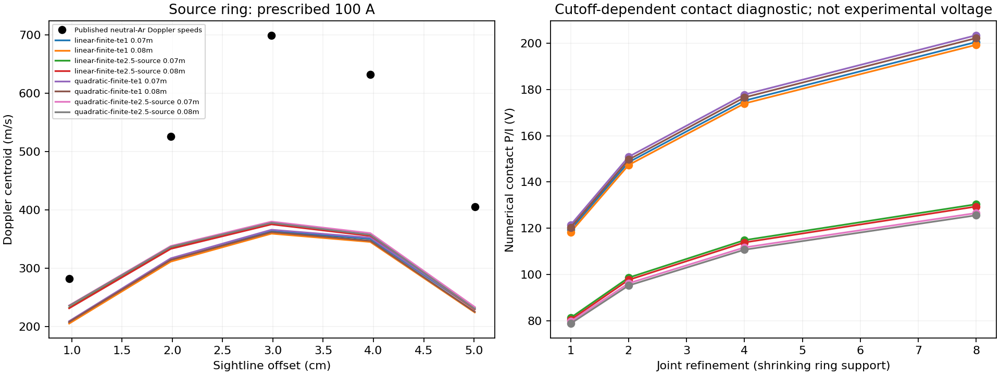
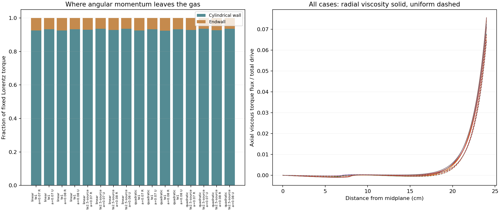

# Axial transport and the current-driven velocity mismatch

12 November 2026. The published uniform-viscosity control still gives **0/576
experimental velocity matches**, as did the retained radial-viscosity baseline.
No currents, velocities or axial profiles were fitted. This study improves the
diagnosis; it does not establish why the real apparatus rotates faster or
qualify the live simulator experimentally. Production physics is unchanged.

## What is missing

The execution trace is `campaign84 -> model82.properties -> transport82.profile
-> model84.solve`. The solver already includes axial current, axial viscous
transport and stationary-endwall braking. Adding another empirical endwall
loss would double count existing stress. Its material properties, however,
are radial profiles extended unchanged along the axis. It omits meridional
mass/momentum advection and the density/energy closure that would determine it.

The [1979 article](https://doi.org/10.1515/zna-1979-0602), §4.5 p.682, explicitly
acknowledges that only midplane information is available and its relevance
elsewhere is unknown. The [1980 follow-up](https://doi.org/10.1515/zna-1980-0815)
again locates measurements in the symmetry plane. Neither recovered source
provides an axial thermal/transport map or measured circulation field for this
comparison. The latter also describes stronger-secondary-flow operation with
lower midplane rotation. Circulation need not increase the measured speed.

Three independent source/model reviewers investigated these assumptions;
a fourth supplied the result auditor. See
[axial evidence](scientific/axial-v85/AXIAL-SOURCES.md),
[meridional evidence](scientific/axial-v85/MERIDIONAL-SOURCES.md) and
[model review](scientific/axial-v85/MODEL-REVIEW.md). The retained original PDF
was rendered offline; complete printed pages 675–676 were newly inspected,
alongside retained apparatus/transport pages. The 1980 evidence is an OCR
rehost, not a newly recovered axial dataset.

## Implemented without fitting

**Historical viscosity control.** Re-solve the coupled current/rotation problem
with the paper's adopted uniform neutral-Ar viscosity, 1.14e-4 Pa s at mean
2900 K. Preserve the four electrical transports, both anode interpretations,
100 A branch-current input and four refinements. This is 32 primary and 32
independently assembled reference solves. It is a historical assumption, not
a measured axial temperature map or a preferred model selected after scoring.
The original radial alternative also remains conditional: an apparent ion-line
width temperature is not automatically local neutral-gas temperature.

**Axial torque accounting.** Reconstruct the Lorentz source, viscous torque
flux and cylindrical-wall/endwall braking in every axial slab. Split fluid
shear dissipation into radial/axial interior and boundary-half-cell terms.
Checks enforce every slab's balance, total torque and the original viscous-work
ledger. At fixed current, `torque = B I (R² − a²)/2`; changes in constitutive
fields redistribute this torque rather than create extra drive.

**Hall-inclusive pressure compatibility.** Evaluate
`Fr = rho r Omega² + B (h / sigmaP) Jr`, using the source's microscopic
conductivities and `rho = mAr (nn + ne)`. This density is a prescribed radial
profile extended axially, not a measured axial density. Current is reconstructed
from saved potential and the reciprocal motional-EMF face law. Integrate
`Fr(z=.12) − Fr(z=.02)` over `r=.01… .05 m`, away from ideal-ring contacts;
retain centrifugal and Hall terms separately. The loop is in Pa and its area
average force-density curl in N/m4.

For the stated no-secondary-flow hypothesis with imposed axial B and no axial
body force, pressure requires `p_r=Fr`, `p_z=0`. A nonzero loop fails that
conditional mechanical compatibility test. It does not supply a circulation
speed or prove that the actual density/temperature/pressure response cannot
change it. Curling acceleration alone would omit baroclinic effects.

Independent review caught a sign-convention error before prediction: original
Eq.7 defines signed Hall conductivity negative; `transport82.hallSM` stores
its positive magnitude. The source's negative force term therefore maps to
the positive `B*h/sigmaP*Jr` above. The original protocol wording is retained
with an explicit pre-prediction erratum. Original-page inspection, electron
Drude balance and manufactured-force/reversal regressions establish the sign.
No previous solver used this newly added radial-force diagnostic.

These are the smallest supported changes. An invented axial taper, imposed
circulation amplitude or extra drag would introduce unknown inputs. A complete
meridional extension must couple mass, radial/axial momentum, angular momentum,
energy and Hall/Pedersen electrical response, including the radial-flow EMF.
Matched thermal/mass/contact boundary data and established-code verification
are separate prerequisites. Singular ideal-ring Joule power cannot serve as
calibrated wall heating.

## Comparison and acceptance boundaries

The [protocol](scientific/axial-v85/PROTOCOL.md) and sign erratum were committed
before new predictions (`be1c13e`, `9c3982e`). Prediction SHA256:
`5654356e7fca335d0bc66c35420eeb2665134e39c84f23a78c7cc625c9d5fc92`.
Scoring reads unchanged velocities only after flow/optical prediction sealing.
This is previously examined development data, not new held-out validation.

All 16 preceding/final optical groups use the unchanged V80 operator and V84
graded-grid adapter. Both edge closures and all 72 temperature/instrument/
centroid-mode alternatives per finest flow case remain retained. All 576 new
alternatives fail both the original all-point and eligible-point 20% criteria.
The baseline's 576 alternatives also remain failures. Prescribed 100 A is an
input; it is never reported as a successful current prediction. Ideal-ring
contact voltage remains cutoff dependent and is not scored electrically.

| Retained family | Alternatives | Velocity matches | Range of worst-point relative error |
|---|---:|---:|---:|
| Radial viscosity baseline |576|0|32.6–51.8%|
| Published uniform viscosity |576|0|45.6–59.9%|

Across the 16 finest paired cases, **92.44–93.58% of the torque leaves through
the cylindrical wall**, and 6.42–7.56% through the endwall. Axial shear accounts
for 4.03–5.55% of total viscous dissipation. These model budgets argue against
repairing the underprediction by adding arbitrary endwall loss. They do not
rule out significant angular-momentum redistribution by real circulation.

The Hall term partly offsets centrifugal forcing, but the fixed-region
pressure-loop residual remains **1.51–19.27 Pa**, conditional on the source
density closure. Its final refinement change is at most **0.1055%**, normalized
by the sum of the two force-component magnitudes. Thus it is a resolved
mechanical incompatibility of the stated torsional hypothesis, not a measured
circulation speed or an identified cause of the optical discrepancy. Final
flow/reference gates and optical spatial/spectral gates pass; maximum optical
flow-refinement change is **0.2772%**.

The figure displays the same declared linear-edge, 2900 K, zero-instrument
centroid slice for all eight cases. It is not a selected best fit. Other
alternatives remain in the compressed comparison packet.

## Retained partition failure

All original **32 final half-cell work failures** remain. The frozen gate asks
relative convergence of dissipation in a numerical region that shrinks with
refinement. For smooth no-slip flow, `Omega_cell~h`, conductance `g~1/h`,
wall torque `g Omega_cell` can remain finite, and gas dissipation
`g Omega_cell²~h` vanishes. Cosine refinement gives `h~n^-2`, so the relative
coarse/fine change approaches 3, or 300%. These are shrinking gas-half-cell
contributions, not power mechanically delivered to a stationary wall.

Two independent derivations and an analytic regression check this interpretation.
The original protocol, thresholds, failed reports and
`allRequiredNumericalPass=false` are preserved. A separately labeled post hoc
assessment compares radial and axial shear work over the fixed whole fluid
volume, and reports half-cell widths/shares/absolute changes. It cannot override
the original failed qualification. See the
[partition review](scientific/axial-v85/PARTITION-REVIEW.md).

The supplemental fixed-volume directional-work change is at most **0.0798%**.
Each finest boundary half-cell contributes at most **0.0185%** of total shear
work; its coarse/fine absolute change is at most **0.0546%** of that total.
These observations support the shrinking-domain explanation while leaving
the original 32 failed relative gates and overall flag unchanged.

## Reproduction and verification

Scientific execution used the offline safe-dev VM from an explicitly synced
**385.7 MiB** stage at `/private/tmp/mass-spinner-public-20261110`, volume
`safe-dev-0b0443eadcbe4bd8`. Three unrelated old V75 stage-result copies were
hash-checked against their originals and moved outside the stage to remain
below the export limit; originals and preserved copies remain intact. No host
credentials, directories or control sockets were mounted.

Run `run85.py flow`, `run85.py optics` and `run85.py final` with
`/work/home/diagnostic-v72-venv/bin/python`, environment
`OPENBLAS_NUM_THREADS=1 OMP_NUM_THREADS=1`, inside the synced VM. The final
runner preserves the failed scientific audit, continues independent optical
scoring/software checks, then returns nonzero for that retained failure.

Exact final checks:

- `python -m unittest discover -p 'test_*85.py' -v`: **27 passed**.
- `python audit85.py results/predictions.json results/audit.json`: **exit 1**,
  retaining 32 final half-cell partition failures; conservation, slab identities,
  flow/reference, pressure-loop and supplemental fixed-volume gates pass.
- `python replay85.py compare`, the unchanged V84 optical auditor, and
  `python summarize85.py`: passed; both 576-alternative families retained.
- `npm test`: **1,238 passed**, none failed or skipped.
- `npm run typecheck` and `npm run build`: passed.

Fourteen initial producer controls passed before the new 32+32 flow solves;
the final 27 include the subsequent shrinking-half-cell analytic and adversarial
auditor regressions. Saved diagnostic identity residuals are at most 2.53e-11.

Receipts and results:
[flow](scientific/axial-v85/results/execution-flow.json),
[optics](scientific/axial-v85/results/execution-optics.json),
[final checks](scientific/axial-v85/results/execution-final.json),
[flow/diagnostic audit](scientific/axial-v85/results/audit.json),
[optical audit](scientific/axial-v85/results/optical-audit.json),
[paired summary](scientific/axial-v85/results/paired-summary.json).
Raw fields, optical packets and command logs are retained. The initial
summary attempt failed because the stage lacked the frozen V84 comparison
summary; its receipt/error are preserved under `results/attempt01`. Restoring
the archived dependency fixed that reporting error without changing code,
predictions or acceptance gates. Earlier prediction packets and README hashes
remain unchanged.

The audits check saved arrays/ledgers, source seals, optical moments and score
reconstruction. The separate reference independently assembles the flow
equations on a shared physical mesh. Spectral-mode optimization and LP dual
optimality are not independently repeated. Neither numerical convergence nor
the supplemental assessment establishes experimental or deployed qualification.
