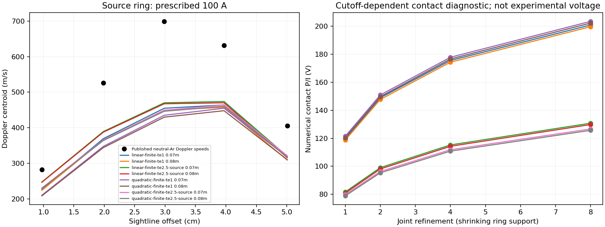

# Cathode current footprint and voltage mapping

12 November 2026. The source-supported current-ring comparison is implemented
and numerically verified. **None of its 576 retained optical alternatives passes
the original experimental velocity criterion.** No current or velocity was fitted.
Experimental accuracy remains unqualified; the live simulator is unchanged.

## What the sources establish

The original [1979 journal article](https://doi.org/10.1515/zna-1979-0602)
specifies a hollow tantalum cathode with **4 mm inner radius**. That is an aperture
dimension, not a measured emitting-current footprint. Its theory prescribes
infinitely thin current rings, with no electrode-potential constraints.

The journal reports terminal 58.0 ±0.5 V and electrode-fall-corrected
18.5 ±2.0 V. It mentions a voltage/current plot but does not supply the raw
series or a correction estimator in the recovered passages. The complete
[conference paper](https://doi.org/10.1051/jphyscol:19797236) independently confirms
that corrected voltage—rounded there to 18 ±2 V—was used to infer Hall
parameters 3 and 9. Those parameters are not independent collision predictions.

Two source agents searched the articles, conference paper, institutional records
and dissertation leads. The retained original journal and both conference pages
were rendered offline and visually checked. No finite emission width, resolved
cathode-current distribution or precise voltage-correction operator was recovered.
The dissertation full text remains unavailable in this search; this is an access
limit, not proof that the details do not exist. The 1980 follow-up describes
different tungsten cathodes and cannot supply the missing tantalum footprint.

[Footprint evidence](scientific/boundary-v84/FOOTPRINT-SOURCES.md) and
[voltage evidence](scientific/boundary-v84/VOLTAGE-SOURCES.md) distinguish direct
observations, mathematical inference, retained-source inspection and failed
retrievals. Original PDFs remain in the source archives:
[journal](scientific/optical-v80/sources/journal.pdf),
[conference](scientific/profile-v79/sources/hal-conference.pdf).

## Root cause and chosen implementation

The previous absolute-voltage model treated the 4 mm aperture radius as a solid
equipotential disk and mapped corrected experimental voltage to its electrode
port. Neither identification follows from the recovered experiment. In plain
terms, a hole's size became the electrical contact's size, and the reported
corrected voltage was equated to a model port voltage whose experimental
meaning is unresolved.

The smallest justified change is a **separate published-theory boundary model**:
prescribe the reported 100 A per branch on ideal cathode/anode rings. Keep the
four previously frozen source-transport alternatives and both anode positions;
retain every case. The earlier 18.5 V disk model stays preserved as a conditional
current-output challenge, with its roughly 20–29 A predictions unresolved.

The new implementation uses Neumann current flux, a single potential gauge,
and shrinking two-cell delta supports that preserve total current and the
cathode's radial second moment. It includes the radial boundary half-face
motional EMF, torque, work and Joule terms. Checks enforce
`torque = B I (R² − a²)/2`, charge conservation and
`electrode power = Joule heat + rotor work`. An independently assembled
velocity-coordinate solver checks the angular-velocity-coordinate producer;
only physical mesh selection is shared.
This remains a steady, fixed-property axisymmetric torsional model; numerical
verification does not establish full experimental dynamics or meridional flow.

This choice reproduces the source boundary without inventing a finite emission
width, a sheath correction or a conductivity multiplier. Selecting those from
the known currents or velocities would conceal the missing experimental inputs.
**100 A is now an input, never a successful current prediction.**

The work-conjugate port diagnostic is
`Vport = −∫ φ J·n dA / I = (QJoule + Wrotor)/I`.
It is gauge invariant, but an ideal zero-width ring has singular self-potential
and cutoff-dependent contact power. For one frozen case, numerical `P/I` rises
119.79 →148.94 →175.56 →200.92 V as support shrinks. These numbers are neither
experimental voltage predictions nor uncertainty bounds. No comparison with
18.5 or 58 V is scored. A finite physical footprint and the measurement operator
are required before that electrical comparison becomes meaningful.

## Results without fitting

The protocol was committed as `38a6fd9` before new predictions. Four transports,
two anode interpretations and four refinements give **32 primary and 32
independent reference solves**. The measured velocities were read for scoring
only after prediction sealing. This remains development-data diagnosis, not
new held-out validation: these measurements had been seen in earlier studies.

- Final conservation/reference identity checks pass; worst relative identity
  residual is **4.27e-11**, against the unchanged 1e-8 gate.
- Final common-chord/work/torque flow changes pass; worst is **0.1031%**,
  against 5%. Five coarse 1→2 chord failures remain visible.
- Sixteen preceding/final flow states were passed through the unchanged V80
  Doppler operator. A checked adapter supplies the actual graded radial edges;
  its legacy interface tag does not masquerade as the flow resolution.
- All **576** final optical alternatives retain the original edge, temperature,
  instrument and centroid/mode choices. No matching alternative was selected.
  Final flow-to-optics change is at most **0.2766%**; all required optical and
  spectral numerical gates pass.
- **0/576** passes the original all-point 20% velocity criterion; none passes
  the eligible-point criterion either. Better boundary fidelity has not removed
  the experimental flow mismatch.

The left panel shows the declared linear-edge, 2900 K, zero-instrument-width
centroid slice for all eight flow cases, not a selected best match. Every other
alternative is retained in the comparison packet. The right panel illustrates
the unqualified contact cutoff diagnostic, not measured bulk voltage.

Independent auditors reconstructed source moments, port work, saved-field
sightlines, exact annular optical centroids/thermal variance, LP primal
feasibility and all 576 scores. They do not independently optimize spectral
modes or prove LP dual optimality. The independent PDE assembly supplies a
separate flow check; the saved-array auditors do not reassemble the PDE.

## Reproduction and checks

All project/scientific execution used the offline Apple safe-dev VM from the
explicitly synced **488.0 MiB** staged copy at
`/private/tmp/mass-spinner-public-20261110`, volume `safe-dev-0b0443eadcbe4bd8`.
The Python executable was `/work/home/diagnostic-v72-venv/bin/python`, with
`OPENBLAS_NUM_THREADS=1 OMP_NUM_THREADS=1`. No host credentials were mounted.
The failed direct publisher retrieval used a separate scoped online invocation;
the actual source review used retained valid PDFs.

Executed checks, all passed:

- `python run84.py flow`: 13 controls, 32 primary and 32 reference solves.
- `python run84.py optics`: 16 optical prediction groups, with original
  optical/spectral refinement and brightness constraints.
- `python -m unittest discover -p 'test_*84.py' -v`: **45 tests**, including
  gauge/reversal/torque controls, stale seals, corruption, missing alternatives,
  input-versus-prediction boundaries and audit failure exit codes.
- `python audit84.py results/predictions.json results/audit.json`: passed.
- `python compare84.py`: sealed predictions unchanged; 576 alternatives scored.
- `python audit_optics84.py results results/optical-audit.json`: passed.
- `npm test`: **1,238 passed**, none failed or skipped.
- `npm run typecheck` and `npm run build`: passed.

[Protocol](scientific/boundary-v84/PROTOCOL.md),
[flow receipt](scientific/boundary-v84/results/execution-flow.json),
[optics receipt](scientific/boundary-v84/results/execution-optics.json),
[final receipt](scientific/boundary-v84/results/execution-final.json),
[flow audit](scientific/boundary-v84/results/audit.json),
[optical audit](scientific/boundary-v84/results/optical-audit.json),
[summary](scientific/boundary-v84/results/summary.json), and
[model review](scientific/boundary-v84/MODEL-REVIEW.md) retain exact producing
source hashes, commands, failures and scope. Compressed flow/optical fields and
raw logs are included. The final receipt binds the final auditor/test revisions;
earlier receipts retain their actual producing revisions.

Prediction SHA256:
`f328e73864378179280f14495fa0963613b9954ddce576dabe91c052f4ea6d74`.
The README, earlier prediction packets and production code were not changed.

The next experimental barrier is still independent finite-emitter/current-map
and voltage-extraction evidence, followed by matched axial transport and flow
conditions. More numerical refinement cannot identify those missing inputs.
