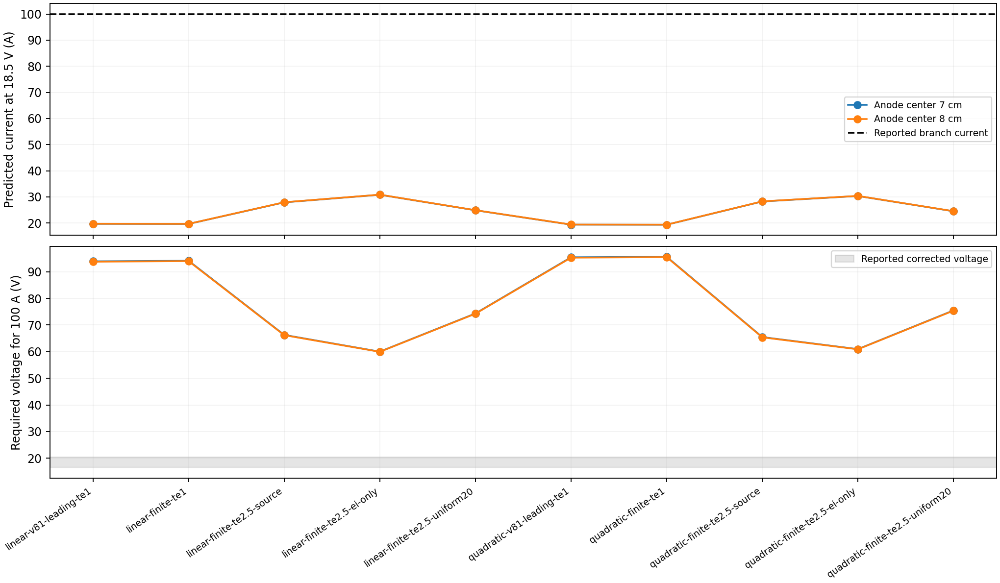

# Why the source-transport model predicts about 20 A, not 100 A

12 November 2026. **The electrical and velocity mismatch remains unresolved.**
The defensible transport update raises the nominal current to about 28 A, not 100 A.
No measured velocity was used to choose geometry, voltage or transport inputs.
This is diagnosis on previously examined data, not new held-out validation.

## What the new calculation establishes

| Finest-grid case, anode centers ±7 cm | Current at 18.5 V | Voltage required for 100 A |
|---|---:|---:|
| Original source transport, linear shape |19.697 A|93.922 V|
| Original source transport, quadratic shape |19.385 A|95.437 V|
| Finite neutral fraction,1 eV, linear |19.653 A|94.133 V|
| Finite neutral fraction,1 eV, quadratic |19.346 A|95.627 V|
| Coupled electron collisions,2.5 eV, linear |27.906 A|66.294 V|
| Coupled electron collisions,2.5 eV, quadratic |28.251 A|65.484 V|

The alternate ±8 cm anode-center interpretation changes these currents by about
0.1–0.14%, rather than the factor of five needed. Across all ten transports and
both geometries, including collision-partition controls, nominal currents are
19.346–30.859 A and required voltages are59.950–95.627 V. Those controls are not
uncertainty bounds. Every fixed 100 A state lies outside the reported corrected
voltage interval 16.5–20.5 V under the assumed identification of modeled port
voltage with corrected arc voltage; that diagnostic mapping is unresolved.

The 100 absolute electrical predictions, 20 locked-flow controls and 20 fixed-current
states are saved before optical scoring. The unchanged V80 optical calculation
produces 80 cases and 5,760 alternatives. **None passes the original 20% criterion**,
either on the original extraction-eligible points or all five points. This holds
separately for 4,320 absolute-voltage and 1,440 fixed-current alternatives. Neither
drive choice reproduces the experiment's current, voltage and measured speeds.

## Origin of the modeled current scale

The traced path is `campaign82 → model82.properties → frozen V81 solver.solve`.
It imposes a conducting cathode **disk** of radius 4 mm in a cylindrical plasma.
The source conductivity and collision estimates inferred from midplane
diagnostics are extended all the way to that disk. This combination strongly
restricts current where it enters the plasma.

For a uniform anisotropic conducting half-space, the independently known disk
law is

`I = 4 a V sqrt(σradial σaxial)`.

With `σaxial=1070 S/m`, `σradial=1070/197 S/m`, `a=0.004 m`, `V=18.5 V`,
the analytical current is 22.565 A. Actual NIST FiPy cylindrical tensor-diffusion
solves give 22.364, 22.506, 22.548 and 22.561 A on four contact-edge refinements;
the finest current error is 0.0213%. In plain terms: current has to squeeze
through a small contact and spread through a poorly conducting radial direction.
This independently explains the scale of the numerical result. It does not prove
that the experimental hollow cathode behaves like that disk, nor bound the finite
device current. The anisotropic access length is about 5.6 cm axially, not 4 mm.

Sources: [Newman's disk derivation](https://escholarship.org/content/qt96z6t5r3/qt96z6t5r3.pdf),
[anisotropic spreading law, Seki et al., Eq.6](https://pmc.ncbi.nlm.nih.gov/articles/PMC7326967/),
[NIST FiPy](https://pages.nist.gov/fipy/en/stable/).

## What was corrected, and why

**Collision-consistent transport.** A conductivity-only gain changes electrical
response without preserving the electron collision physics. At fixed density,
field and Coulomb logarithm, both `σparallel` and `βelectron` vary inversely with
the electron relaxation rate. We now change them together using

`g(Te) = 1 / [(1−f) Te^(−3/2) + f Te^(1/2)]`,

then recompute the full ion-slip tensor. Here Te is relative to1 eV; f is the
reference electron-neutral collision fraction. We separately retain the source's
leading weak-ionization limit and its finite neutral mass fraction **squared**.
The former was already one, so this square was not a hidden factor-five bug.
Source-derived f uses the published neutral-density estimates and Qen; those
densities include an assumed/extrapolated central pressure. f=0 and
uniform 0.2 are labelled controls. The 2.5 eV alternative is source-motivated,
not a measured axial temperature map or a self-consistent discharge solution.
This is preferable to multiplying conductivity until current matches.

**Electrical losses and work.** The new diagnostic reconstructs face current,
half-cell Joule loss, motional work and electrical inflow from the saved fields.
The identity is `Pport = QJoule + Wrotor`; local rotor work is not automatically
local viscous heating because stresses transport energy. Regional power divided
by current is a **volt-equivalent budget**, not a local probe voltage drop. Both
actual region edges and separate regional-refinement failures are retained.
Nominal fixed-depth cuts use cell-center masks, selecting different physical
regions across meshes; their changes mix domain movement with discretization.

**Honest comparison.** Optical point-match flags are retained under the original
criterion, but explicitly separated from optical convergence, voltage compatibility,
current agreement and experimental qualification. Absolute 18.5 V and fixed 100 A
states are distinct operating-point challenges. Exact linear scaling to 100 A is
valid only for these frozen-property equations; it does not include heating or
density changes. Regression tests cover incompatible voltages, unresolved optics,
drive labels and stale seals.

**Output-boundary bugs.** Execution exposed NumPy booleans in JSON, list arithmetic
in the independent auditor, and relative-path root inference in its CLI. Native
output scalars, NumPy array operations and resolved input paths fix the respective
causes. Regressions exercise serialization, JSON-list controls and the exact
relative CLI paths. No physical threshold was relaxed.

## What cannot be repaired from the published information

The [original experiment](https://doi.org/10.1515/zna-1979-0602) specifies 100 A per
discharge branch, 48 cm cathode separation, 12 cm central bore, 4 mm hollow-cathode
**inner** radius and 2 cm anodes. No factor-two, unit or polarity bug was found.
Its theoretical delta-ring current boundary and our finite conducting disk are
different idealizations. The source does not uniquely specify the emitting/current
footprint, near-cathode taper dimensions, axial conductivity map or plasma-side
sheaths of the floating metal rings. Digitizing schematic pixels or grounding
floating walls would invent inputs.

The 58 V terminal voltage includes electrode falls; the corrected 18.5±2 V does
not. The published V–I correction does not identify our finite-contact,
current-weighted spatial voltage operator. Substituting 58 V as bulk voltage would
incorrectly assign electrode-fall voltage to the modeled bulk plasma. Required
model voltages near 65 V therefore do not validate against a 58 V terminal measurement.

The next decisive evidence is an independently specified cathode current footprint,
near-cathode transport measurements and a documented plasma-voltage diagnostic
operator. A conditional ring/sheath or axial-transport model could explore these
unknowns, but choosing its parameters from the known velocities would be fitting.

## Reproduction and evidence

The [frozen protocol](scientific/electrical-v82/PROTOCOL.md) predates the new
predictions. Independent source reviews cover
[geometry](scientific/electrical-v82/GEOMETRY-AUDIT.md),
[voltage](scientific/electrical-v82/VOLTAGE-AUDIT.md) and
[transport](scientific/electrical-v82/TRANSPORT-AUDIT.md).
All project execution is offline inside the existing safe-dev Apple VM. The final
review uses the explicitly synced 499.1 MiB source copy in
`/private/tmp/mass-spinner-public-20261110`; generated results were exported before
every replacement. Unneeded old stage copies were archived outside the snapshot;
original research results were preserved.

The independent result-only audits report:

| Gate | Result |
|---|---|
| Original final global flow/current/power refinement,5% |Pass; worst3.986%|
| Final current refinement |Worst2.071%|
| Final uniform-chord refinement |Worst3.827%|
| Same-conductivity independent current/chord comparison |Worst0.0481% /0.0429%|
| Reconstructed cell/global/regional power identities,1e-8 |Pass; worst6.62e-11|
| Fixed-property linear drive scaling,1e-8 |Pass; worst7.93e-14|
| Locked-flow passivity |Pass|
| Independent FiPy disk benchmark |Pass|
| Optical identities/refinement/flux/primal LP certificates |Pass; no unavailable bounds|
| Regional budget refinement,5% |**Fail;72 final failures retained**|
| Original experimental velocity criterion,20% |**Fail in all5,760 alternatives**|

The regional failures comprise20 anode-band Joule budgets,40 thin4 mm endwall
budgets and12 other16 mm endwall budgets. The anode-band boundaries are fixed;
the selected near-endwall masks move with the mesh. Neither regional convergence
nor an experimentally resolved voltage profile is claimed. At the nominal linear
finest grid, total input is364.40 W, Joule loss347.25 W and rotor work17.15 W;
314.99 W of Joule loss lies on the cathode side of the anode band. These are
conditional cell-budget results, not local voltage measurements.

The first independent audit also compared velocity values at different radial
centers. The reference uses arithmetic centers while the primary uses volume
centers, producing an artificial approximately29% difference near the axis even
for solid rotation. Those raw values remain in an explicit coordinate assessment;
qualification uses the original shared sightline/current/power observables. A
second artifact divided tiny differences of nearly cancelling cell powers by
tiny local net power. The corrected scaling test normalizes the absolute power
difference by total input power, retaining the1e-8 threshold and tests that reject
material errors. This avoids inventing a velocity interpolation or relaxing the
physical gates. Both pre-review and reviewed audit outputs are preserved.

Exact commands, exit codes and source hashes are recorded in
[`execution-predict.json`](scientific/electrical-v82/results/execution-predict.json),
[`execution-final.json`](scientific/electrical-v82/results/execution-final.json)
and [`execution-review.json`](scientific/electrical-v82/results/execution-review.json).
The initial execution/serialization/path failures remain in logs rather than
being described as successful runs. The checked commands include:

- `python -m unittest test_access82 test_transport82 test_model82 test_audit82 -v`,
  then the final12-test `test_audit82` rerun after the audit corrections.
- `python -m unittest test_audit_optics82 test_compare82 test_campaign82 -v`:
  16 passing tests. Together the final V82 methods total45.
- `python -m unittest discover -s ../profile-v79 -p 'test_*.py' -v`, and the same
  command for `../optical-v80` and `../flow-v81`:16,27 and41 tests passed.
- `python access82.py results/access-results.json`, `python campaign82.py`,
  `python optics82.py`, `python compare82.py`, the independent `audit82.py` and
  `audit_optics82.py` CLIs: completed; physical failure flags remain as above.
- `npm test`:1,238 passed; `npm run typecheck` and `npm run build`: exit0.

Sealed prediction SHA256:
`8b4041c7db6ee606db57dca695da350919c7a6f0c29727f2dbd3ac010ecd857e`.
The [electrical audit](scientific/electrical-v82/results/electrical-audit.json),
[optical audit](scientific/electrical-v82/results/optical-audit.json) and
[summary](scientific/electrical-v82/results/summary.json) bind their saved inputs.
V79–V81 prediction seals and README hash remain unchanged. Production physics and
the deployed playground were not changed by this research study.
