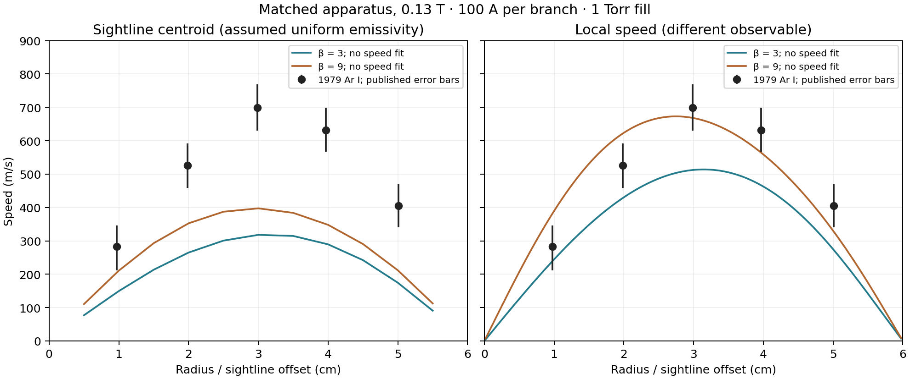

# Measured rotation profile: numerical pass, experimental failure

11 November 2026. **The homogeneous, single-fluid model does not reproduce the
measured optical rotation profile within the frozen 20% criterion.** This is
an offline research comparison, not experimental qualification of the playground
or a Marathon apparatus.

## Experiment and independence

[Wijnakker & Granneman, 1979, Figure 2](https://hal.science/jpa-00219219/document)
provides five resolvable neutral-Ar symbols. The
[journal paper](https://doi.org/10.1515/zna-1979-0602) supplies fuller apparatus
details. These are the same apparatus/operating case, probably the same data;
exact shot identity is unconfirmed. They are not two independent experiments.

The paper and reported maxima had been read before model selection. Only marker
coordinates were prospectively withheld. The protocol was committed in
`f558e1f`, the conference-source alias in `b3e157f`, and predictions in `65e469b`
before digitization. This is not a wholly unseen experimental condition.

Matched inputs: radius 6 cm, cathode spacing 48 cm, anodes at ±7 cm, 2 cm ring
width, B=0.13 T, 100 A **per opposed branch**, 1 Torr fill behind the cathodes.
The symmetric half apparatus has one 100 A circuit. The cathode disk radius
4 mm is an assumed current footprint based on the hollow-cathode inner radius.

Freeze viscosity at the paper's 1.14e-4 Pa s estimate for mean 2900 K; evaluate
both effective anisotropies β=3 and 9. Condition only scalar conductivity on
100 A at the corrected bulk voltage 18.5 V. Repeat at 16.5 and 20.5 V.
**No measured rotation speed enters the solver or electrical calibration.**

## Results without velocity refitting

| Sightline offset, approximately | Measured m/s | β=3 centroid m/s | β=9 centroid m/s |
|---|---:|---:|---:|
| 1 cm | 282 | 146 | 205 |
| 2 cm | 526 | 263 | 351 |
| 3 cm | 699 | 317 | 397 |
| 4 cm | 632 | 291 | 350 |
| 5 cm | 405 | 173 | 210 |

Nominal worst point errors are **57.3% / 48.1%** for β=3/9; RMS divided by
measured peak is **40.6% / 31.7%**. Both fail. At the three points meeting the
conservative 5% extraction gate, even the favorable extraction-interval errors
remain above 20%. Neither voltage alternative repairs the discrepancy.

The published measurement is a sightline Doppler shift without Abel inversion.
The exact spectral estimator and local emissivity are unknown. The tested
observation operator is an optically thin, uniform-local-emissivity centroid.
The local-speed panel is a different observable: its closer appearance cannot
be used to pass the optical comparison.

An independent agent digitized the graphic without reading predictions. Five
symbols and published vertical bars are retained; the legend, theory curves and
unresolvable features overlapping the axis are excluded. Pixel-box bounds
propagate ±6 crop pixels in each marker and both endpoint ticks; intermediate
ticks are checked. First and outermost symbols fail the 5% extraction gate but
remain in all-point scores. Bounds are per-point extraction ranges, not
confidence intervals or experimental uncertainty coverage.

## Numerical and physics audit

The new steady 2D finite-volume model solves charge continuity and azimuthal
viscous balance with motional feedback:

`Jr = σparallel/(1+β²) (−∂rφ + B r Ω)`, `Jz = −σparallel ∂zφ`;
`0 = (1/r)∂r(μ r³ ∂rΩ) + ∂z(μ r² ∂zΩ) − r B Jr`.

No-slip side/end walls, symmetric midplane, and insulating non-electrode faces
close the declared problem. The current network and torque use the same
power-adjoint coupling. Electrical power equals Joule plus viscous dissipation.
This replaces the earlier assumed radial-current profile only in this research
comparison; it does not add a discharge, temperature or meridional-flow closure.

Three meshes: 32×48, 64×96, 128×192. Finest chord changes are **1.23% / 1.77%**;
conductivity changes **3.67% / 2.33%**. All frozen 5% refinement gates pass.
An independent velocity-coordinate discretization differs by **0.034% / 0.037%**
in finest-grid chord speeds at the same conductivity. All global charge,
torque and power gates pass below 1e-8. The reference's additional local momentum
residual reaches 7.36e-8; this adverse conditioning diagnostic is retained.

An independent current-loop torque identity gives 0.023296–0.0234 N m per
half apparatus. The reference torque lies inside it. Thus the large optical
discrepancy is not explained by these discretization errors or a missing
factor of two in total current. Its physical cause is not uniquely identified.

The model still assumes homogeneous conductivity/viscosity, negligible
ion-neutral velocity slip, isotropic viscosity, a disk cathode footprint, and
no meridional circulation. Missing optical weighting and uncertain transport
properties prevent attribution of the discrepancy to one mechanism.

## Reproduction and next evidence

Use safe-dev and the versions in
[verification.json](scientific/profile-v79/results/verification.json).
Run `study.py OUTPUT_DIRECTORY`, the three `test_*.py` suites,
`audit_numerics.py predictions.json OUTPUT.json`, then `score.py` from
`scientific/profile-v79`. Scoring verifies the sealed prediction, source PDF
and crop hashes. [Protocol](scientific/profile-v79/PROTOCOL.md),
[digitization](scientific/profile-v79/digitization-independent.json),
[numerics](scientific/profile-v79/results/numerics.json), and
[scores](scientific/profile-v79/results/score.json) retain all cases.

Final checks, all inside the isolated VM: `python -m unittest discover -s
scientific/profile-v79 -p 'test_*.py' -v` (**16 passed**), numerical audit
(passed), scoring (completed with both experimental cases failing),
`npm run test` (**1,238 passed**), `npm run typecheck` and `npm run build`
(both passed). Build retains the existing >500 kB chunk warning. The imported
snapshot excluding result folders, bytecode and `dist` has 1,691 files and digest
`e4a80b450ea169416986dda8cf3cbb6c15027d8fdbb0d2837c00a789e3bc6d7a`;
the receipt additionally hashes every direct scientific source/config file.

Audits corrected extraction bounds to include radius and tick uncertainty,
prevented empty eligible sets from passing, and included wrong-sign predictions
in interval extrema. Analytic interval corners were chosen over statistical
sampling because the uncertainty is a declared pixel range, not a probability
distribution. Tests cover these cases and JSON serialization of extracted data.

The next useful evidence is the actual spectral estimator/emission weighting,
independent spatial temperature/transport data and the cathode current footprint.
Further model changes may use this case as development data, but need a new
confirmation condition. **Do not retune viscosity, current or optical weighting
against these velocities and call the same profile held out again.**
