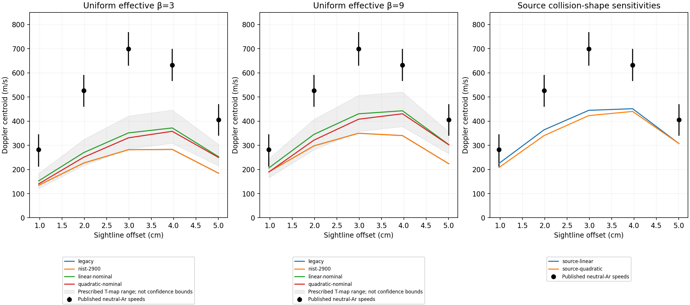

# Spatial transport and the remaining rotation mismatch

12 November 2026. Research-only follow-up to [V80](OPTICAL-DIAGNOSTIC-V80.md).
No playground physics, controls or graphics are changed. Experimental
qualification remains false. These velocities have already been seen during
development; this is not a fresh held-out validation.

## What changed and why

The traced prediction path is `campaign.py → transport.py → solver.py`, with
`reference.py` independently assembling the same continuum problem. Frozen V79
apparatus/electrical inputs determine each solution; measured velocities enter
only through `compare.py` after field packets and optical predictions are sealed.
`optics.py` reuses the unchanged V80 brightness and Doppler operators.

**Spatial constitutive transport.** V79 used a single viscosity and conductivity
ratio everywhere, while the experimental paper explicitly discusses radial
transport variation. In technical terms, replacing the variable-coefficient
operator by a constant removes property gradients from the stress/current
divergence. Simply multiplying a finished velocity by a temperature correction
cannot recover that coupling. In plain terms, different parts of the gas resist
shear and conduct current differently; changing the final answer does not move
those losses to the right places.

The new finite-volume operator places positive local coefficients inside
cylindrical half-cell series resistances. For a radial face at f between centers
a,b, electrical resistance is `[ln(f/a)/σP(a)+ln(b/f)/σP(b)]/(2πΔz)`;
angular shear resistance is
`[(a⁻²−f⁻²)/μ(a)+(f⁻²−b⁻²)/μ(b)]/(4πΔz)`.
Axial resistances use their physical half-cell lengths. Motional EMF and torque
remain adjoints, preserving the discrete work exchange. This is the smallest
change that captures prescribed spatial transport while retaining the verified
charge/shear problem; a full new CFD solver would introduce additional unclosed
physics before testing this omission.

**Property evidence.** Neutral-Ar dilute viscosity uses the
[2025 NIST reference correlation](https://doi.org/10.1007/s10765-025-03603-8),
Eq.2/Table3, all 12 coefficients, valid84–10000K. The independent published300K
check is22.6840μPa·s. The quoted0.12% pure-gas property uncertainty is not an
uncertainty on a plasma flow or temperature reconstruction. The official
[NIST PDF](https://tsapps.nist.gov/publication/get_pdf.cfm?pub_id=960065)
was checked through its web text; a local download returned403 and no archived
PDF checksum is claimed.

All12 predeclared thermal cases remain visible: legacy constantμ, NIST at2900K,
and linear/quadratic radial profiles with nominal and four corner endpoint
combinations. Core5950±1300K is an apparent ion-linewidth estimate, while
1800±400K at5cm is a corrected probe estimate. Neither establishes the local
neutral temperature throughout the vessel. Axial uniformity, interpolation and
constant continuation outside5cm are assumptions; corners are not confidence
bounds. The linear radial profile is retained as a sensitivity despite lacking
zero scalar derivative on axis; the quadratic profile is axis regular.

Two additional cases interpolate the source's §4.7 collision estimates before
mapping to the effective conductivity tensor: σ∥1070→950S/m, βe100→38,
βi0.94→0.18. With neutral mass fraction approximated by one,
`s=βeβi`, `σP=σ∥(1+s)/[(1+s)²+βe²]` and
`βeff²=s+βe²/(1+s)`. These imply endpoint βeff≈14, rather than selecting a new beta
from velocity residuals. They remain conditional estimates, not a measured2D
transport map. Each reports current at absolute source conductivity before any
electrical-only normalization to100A; fixing Hall profiles while scalingσ∥ is
phenomenological, not a microscopic collision closure.
In source-case packets, scalar `beta=0` is an unused grouping key: the supplied
spatial field sets transport. Its actual range is in `propertyRanges.effectiveBeta`;
the optical index and flow audit explicitly record this convention. These are
magnetized cases, not zero-Hall controls.

**Independent reference conditioning.** Three initial reference controls failed
at tiny near-axis errors because the sparse system mixed voltage and velocity
coordinates with very different numerical scales. In plain terms, the same
equations lost a small amount of precision when written in mismatched units.
Symmetric diagonal equilibration now rescales coordinates before sparse LU and
recovers physical units afterward. The PDE, meshes and experimental tolerances
are unchanged. The uniform-baseline control uses a global normalized field error
instead of per-entry relative errors near zero; scaling-invariance controls
remain unchanged. All23 initial transport/solver controls then passed. This
addresses conditioning directly, rather than adding artificial viscosity or
relaxing conservation gates.

## What secondary circulation can and cannot explain

The [1979 experiment](https://doi.org/10.1515/zna-1979-0602), §3,p.677,
expects meridional circulation because rotation and centrifugal pressure vary
axially near stationary endwalls. The model now reports the centrifugal-only
curl `∂z(rΩ²)` and derivative-free radial loop integrals from saved2D fields.
The saved "midplane" loop starts at the first cell center near z=0, not an exact
boundary sample; both endpoints move toward their physical planes on refinement.
The legacy β=3 case actually has a negative first-to-last-cell loop despite a
positive first-cell-to-stationary-wall loop: concentrated near-cathode rotation
precludes a claim of monotonic endwall braking everywhere. Conditional Mach
numbers also exceed one in several legacy/cold scenarios (legacy β=3:1.64),
whereas nominal quadratic β=9 gives0.64. These prescribed-temperature estimates
do not justify a globally constant-density, low-Mach circulation closure.
Nonzero values expose a force-balance requirement; they do not predict a
circulation speed or prove circulation is the cause of the optical residual.

For zero meridional flow, pressure must satisfy
`pr=ρrΩ²+fr`, `pz=fz`, hence
`∂z(ρrΩ²+fr)−∂r(fz)=0`.
Density/thermal baroclinicity and Hall radial force can alter this balance.
The effective beta fixes σP/σ∥ but does not uniquely identify Hall conductivity
with ion slip. A coupled circulation prediction also needs density/energy and
hollow-cathode gas injection/exhaust conditions. Adding an adjustable circulation
or endwall drag would conceal these missing inputs and can count resolved wall
shear twice. The full equations, boundaries and established OpenFOAM/DOLFINx
implementation routes are in
[the independent meridional assessment](scientific/flow-v81/MERIDIONAL-ASSESSMENT.md).

The paper's ideal Neumann current rings also differ from the retained conducting
cathode disk. A zero-width ring has a potentially singular spreading potential;
using a mesh-cell footprint and conditioning its voltage would invent apparatus
information. The exact uniform-B current-moment identity bounds the disk/ring
change in total electromagnetic drive torque below≈0.45% for these dimensions.
It cannot by itself explain a roughly50% deficit through total torque, although
local current/flow and voltage conditioning can change.

## Results and verification

The frozen campaign contains **130 flow cases,14 optical groups,78 finest-grid
optical cases and5,616 scored alternatives**. No measured velocity conditions a
prediction. **Zero alternatives pass the unchanged20% criterion**, both for all
five points and for the original three-point extraction mask.

Representative predicted Doppler centroids in m/s, at the five unchanged
sightlines, for18.5V and linear brightness-edge continuation:

| Scenario | ≈1cm | ≈2cm | ≈3cm | ≈4cm | ≈5cm |
|---|---:|---:|---:|---:|---:|
| Measured neutral Ar | 282 | 526 | 699 | 632 | 405 |
| Legacy, β=9 | 190 | 298 | 350 | 340 | 224 |
| Quadratic nominal T, β=9 | 189 | 321 | 408 | 431 | 302 |
| Linear nominal T, β=9 | 206 | 345 | 431 | 443 | 303 |
| Source collision shape, quadratic | 208 | 340 | 423 | 440 | 307 |
| Source collision shape, linear | 225 | 364 | 445 | 452 | 307 |

These are centroids; their values do not depend on the Gaussian broadening
choice. All frozen mode, temperature, instrument, voltage and edge-closure
alternatives remain in the scored packet. No profile is selected as a fit.

At absolute source conductivity, the finest-grid linear/quadratic cases predict
**19.697/19.385A**, rather than100A. Electrical conditioning requires gains of
**6.311/6.299** relative to the source conductivity normalization. Thus the
retained apparatus/transport assumptions do not reproduce the electrical
operating point either. This does not prove a unique source of error: electrode
footprint, voltage mapping and inferred transport remain conditional.

The independent sealed-result audits distinguish three outcomes:

- **Flow numerical gates pass.** Final32→64→128 radial refinement comparisons
  use the last pair: maximum uniform-chord change1.812%, conductivity change
  3.668%, Joule-power change0.419%, viscous-power change1.336%. All remain below
  the unchanged5% limit. Maximum finest-grid same-conductivity independent
  reference chord difference is0.0389%; maximum reference shear-power difference
  is0.0748%. Primary conservation/residual gates remain below3.69×10⁻¹¹.
- **Optical numerical gates pass.** No final optical/bin/flux/hull or saved-primal
  LP-certificate failures; no unavailable LP bounds. The largest128→256 optical
  centroid difference is0.0265%. This audit verifies saved primal certificates,
  not an independent LP solve or dual certificate; it does not identify the
  original instrument's estimator or same-line emissivity.
- **Meridional assessment is unresolved.**67 final5% refinement gates fail:
  26 curl maxima,16 volume-RMS curls and25 first-to-last-cell loop integrals.
  The first-to-stationary-wall loop passes for every case. Moving cell-center
  endpoints, near-cathode gradients and cancellation affect the other diagnostics;
  a large relative error around a near-zero loop is retained rather than waived.
  Converged integrated rotation does not qualify these derivatives or an actual
  circulation model.

The correct next coupled model needs independently specified density/energy,
signed Hall force and gas/electrode boundary conditions, with joint endwall and
electrode refinement. Establishing those inputs and checking the electrical
operating point should precede any claim that circulation repairs the measured
rotation. No tunable circulation speed or drag was introduced.

## Exact checks and tested snapshot

All scientific execution occurred offline inside Apple safe-dev VM
`safe-dev-0b0443eadcbe4bd8`, using the explicitly refreshed COPY at
`/private/tmp/mass-spinner-public-20261110`. Full guest snapshots are preserved
under `/work/home/flow-v81-physical-full01` and `flow-v81-final-full01`.

`results/verification.json` records command arrays, exit codes, durations and
source SHA256s: V81 unittest discovery40/40; V79 discovery16/16; V80
discovery27/27; independent flow and optical audits; separate optical production,
scoring and summary; `npm run test`1238/1238; `npm run typecheck`; `npm run build`.
Each command exited0. The auditors retain the scientific failures above rather
than turning them into execution failures.

Post-review checks add a regression for summary labels: assessment failures must
not be presented as failed flow gates. The plot legend was also moved outside
the data area and all comparison panels now share a vertical scale. These change
reporting only; the post-review receipt binds the final source bytes and reruns
the affected scientific checks without regenerating unchanged predictions.

Frozen flow packet SHA256:
`1cda6cc3b87e1cffefde611d55122855911391e8ccab538b59b27a72a904ab1d`.
V79/V80 prediction seals and README bytes remain unchanged. No live playground
or deployment is altered by this research study.

Machine-readable artifacts and exact source receipts live in
[`scientific/flow-v81/results`](scientific/flow-v81/results).
