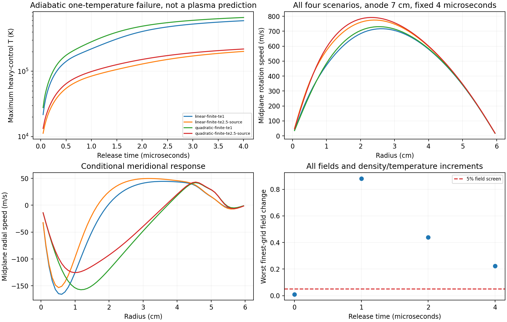
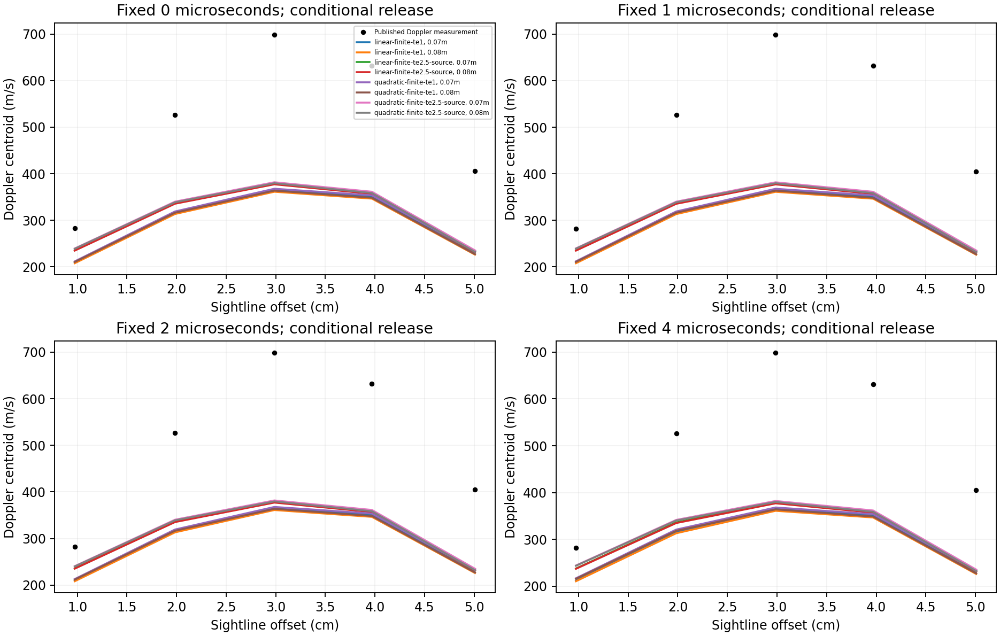

# Coupled meridional transport: conditional release, not device validation

12 November 2026. Research backend; production physics and the live playground
are unchanged. Coupling is implemented; numerical and experimental qualification
remain **false**.

## Problem and root cause

The previous current-driven torsional model includes axial electric current,
axial viscosity and endwall braking, but extends prescribed radial material
profiles along the axis. Its nonzero pressure-compatibility loop does not give
a circulation speed. Density, radial/axial momentum, angular momentum and
energy must respond together; adding an empirical drag or circulation amplitude
would not close those equations.

In plain terms, calculating rotation alone leaves out how gas moves, expands
and carries heat when the required pressure cannot balance it.

## Implementation and tool choice

The new, separate backend reuses V75's conservative cylindrical finite-volume
MUSCL/Rusanov SSPRK2 transport. Its state contains integrated mass, radial and
axial momentum, angular momentum, total energy and a passive composition
coordinate. Both masses are natural Ar here; that coordinate does not predict
ionization. Pressure follows a monatomic ideal-gas EOS. All advected quantities
share the same mass flux. Total energy contains all three kinetic components.

Actual **scikit-fem 12.0.2** assembles the full cylindrical Newtonian deviatoric
stress and adiabatic conduction, including hoop strain and cross derivatives.
The hybrid method uses Q1 fields on FV centroid/boundary nodes and actual FV
mass/inertia/heat capacities. Zero-capacity natural boundary traces are solved,
not treated as artificial gas cells. Stationary walls have zero velocity;
axis/midplane conditions distinguish regularity from no slip. Quadrature
dissipation and backward-Euler damping return to internal energy, with local
stress-energy redistribution retained. Convergence is required; this assembly
library does not by itself qualify the hybrid method.

A monolithic Hall source step solves potential and both transverse momenta.
For positive stored Hall magnitude h,

`E'r=-phi_r+B u_theta`, `E'theta=-B u_r`,
`Jr=sigmaP E'r-h E'theta`, `Jtheta=h E'r+sigmaP E'theta`.

Thus radial motion affects charge, radial magnetic braking and rotational
drive. Series-segment current, force, electrode work and Ohmic heat use the
same geometry. The ledger enforces `J.E=Qohm+u.(J×B)`; the implicit kinetic
defect is numerical heat, not an additional external source. Energy is not
counted twice.

An **actual FiPy** scalar heat solve and an analytic cylindrical eigenmode
provide separate verification. OpenFOAM and PETSc were reviewed as stronger
general thermofluid foundations. Neither has the required weakly ionized Hall,
contact and optical closures ready to insert here. This bounded extension
reuses previously tested transport and established matrix assembly without claiming a
complete industrial plasma-CFD solver. See
[tool review](scientific/meridional-v86/CODE-REVIEW.md) and
[equations](scientific/meridional-v86/EQUATION-REVIEW.md).

## Fixed inputs and physical limits

The [protocol](scientific/meridional-v86/PROTOCOL.md) was committed before full
predictions, with a separately recorded pre-campaign quadrature detail after
the pilot. Same four source electrical scenarios, both anode positions and
prescribed 100 A per branch. No current or velocity fitting. The finite anode
uses the published 2 cm width. A uniform 4 mm radius cathode disk is an
explicit regularization; the source gives a hollow-cathode inner radius, not
its emitting-current footprint.
These are the [1979 argon benchmark](EXPERIMENTAL-PROFILE-V79.md) conditions, not Marathon machine geometry
or an experimental qualification of Marathon's design.

Closed, adiabatic, stationary walls and prescribed microscopic electrical
coefficients define a **conditional release**. Density and temperature evolve,
but electron temperature, ionization and conductivity do not close themselves.
All Ohmic heat goes to one heavy-gas temperature; no measured electron–heavy
energy partition, cooling law or injection rate was supplied. Constant
published viscosity and a monatomic Eucken conductivity are mathematical
control coefficients, not verified properties at extreme temperature.

The original papers do not supply the missing matched thermal boundaries.
The 1980 paper's 400 K wall is a theoretical assumption in a different
apparatus, not a measured 1979 boundary. A closed system with positive
electrical power has no thermal steady state. We therefore report all fixed
times 0,1,2,4 microseconds, without choosing the best-matching clock.

## Optical and audit safeguards

The new two-sided LOS operator includes radial Doppler motion. Symmetry
cancels its centroid contribution but preserves broadening and possible mode
changes. Measured brightness and all 72 frozen thermal/instrument/estimator
alternatives remain. On an overheated conditional state these are diagnostic
sensitivities, not predictions of that gas's emission. Every time is scored
separately against the unchanged previously viewed development measurements.

Independent review found and fixed four comparator defects before the final
sealed replay: positional pairing of alternatives, duplicate/missing groups,
unchecked source/diagnostic seals and ambiguous sightline ordering. Pairing now
uses full identities, requires the complete group/alternative inventory,
canonicalizes point IDs and rejects stale evidence. Explicit unavailable cases
cannot count as zero experimental matches or successful convergence.

The first full optical run exposed an additional integration bug: prediction
stores sightline IDs/radii, while its checker expected the source records'
extra extraction-range metadata too. The gas had not moved incorrectly; two
representations of the same sightlines failed an exact dictionary comparison.
The fix projects only the expected fixture onto the predictor's declared
ID/radius contract. It still rejects changed IDs/radii or extra prediction keys
and seals the complete original diagnostic file. This preserves provenance
without weakening checks or inventing propagation of coordinate uncertainty.
A regression uses the actual fixture and predictor, with three corruption
checks. The failed attempt is retained under `results/failure02`; predictions
are replayed with final source seals before scoring.

Saved-state auditing independently reconstructs EOS/inertia, global
mass/species/energy and the reporting-time budgets. Intermediate history has
producer residuals rather than every intermediate state; its local rows are
not independently reconstructed from those scalar logs. Separate source tests
rebuild charge/force/heat directly. Fixed-volume spatial/timestep and physical
quadrature gates remain independent of experimental scores. Failures are
retained; no thresholds, heating fractions or contact sizes are tuned.

The independent stress review found no demonstrated sign or global-energy
defect. It preserves three limits: quadrature heat placement is not an exact
FE/FV-overlap integration; Q1 conduction has no general discrete maximum
principle on arbitrary stretched grids; and this first campaign does not save
a full-trajectory wall-reaction ledger. Separate operator controls test angular
momentum against stationary-wall reaction, but cannot replace that trajectory
diagnostic. See [independent review](scientific/meridional-v86/DIFFUSION-INDEPENDENT.md).

## Results and verification

Three full campaigns completed all 26 flow cases. The first source snapshot,
fields and failed audit remain under `results/attempt01`. Original gates
reported **85 field failures and 335 quadrature failures**. Those failures are
retained, not replaced by a favorable supplemental analysis.

Two distinct numerical problems were identified. Global Gauss sampling crosses
piecewise-bilinear interpolation knots and under-resolves some field-comparison
integrals. A separately labeled post hoc checker instead integrates each union
panel exactly with a 2×2 Gauss rule, with 3×3/4×4 witnesses. This diagnoses
integration error; it cannot waive actual field error or the original failed
qualification.
In the completed supplemental calculation, all quadrature-order checks pass
but **all 85 field failures remain**. Better integration therefore does not
resolve the coupled flow's spatial/temporal qualification.
The 64 spatial failures all contract under refinement, but exceed the 5%
screen: density increments differ by 20.25–87.22%, radial velocity by
5.24–11.10%, axial velocity by 5.22–6.44%, whole temperature by 5.32% in two
cases, and temperature increments by 5.66–5.72% in four. Whole-state density
agreement must not conceal poorly resolved density changes.

The nominal 0.1/0.05/0.025 microsecond cap contrast also fails to establish
temporal convergence. Acoustic CFL already limits the finest calculation:
the first two schedules have 654 steps and are identical; the third has 655.
Actual CFL or active-timestep refinement is still needed. Lowering an inactive
cap is not evidence of smaller timesteps.
The 21 time gates fail contraction, rather than the 2% magnitude screen; the
largest change is 0.4204% in the density increment. This is an ineffective
refinement contrast, not evidence of a large demonstrated timestep error.

The full spectral comparison initially exposed a computational bottleneck.
An explicitly selected Fourier Gaussian-mixture integrator retains analytic
bin integration, exact-CDF flux/mode checks and the unchanged direct-CDF
reference. It changes numerical integration only. Its gates were recorded
before optical predictions and target scoring. The 24 standalone controls and
all **84 predeclared actual-field witnesses passed**. Direct-CDF evaluation took
3.856 s and Fourier evaluation 0.272 s on the final witness set; this is a measured
local speedup, not a whole-campaign performance guarantee. **All 26 replayed
field packets, saved states and histories are bitwise identical** to attempt01.
The new prediction manifest differs because it seals the final numerical
optical integration sources, not because physical flow fields changed.

All 64 optical groups and **2,304 alternatives** completed. All numerical
optical gates pass; no case is unavailable. The unchanged experimental screen
requires every measured velocity to agree within 20%:

| Fixed release time | Alternatives | All-point matches | Numerical optical failures |
|---|---:|---:|---:|
| 0 microseconds | 576 | 0 | 0 |
| 1 microsecond | 576 | 0 | 0 |
| 2 microseconds | 576 | 0 | 0 |
| 4 microseconds | 576 | 0 | 0 |

This conditional circulation/energy extension does **not** recover the measured
profile. Passing optical refinement removes that numerical explanation for
this comparison; it does not repair the unresolved flow or thermal closure.
These remain previously viewed development measurements, not fresh holdouts.

Temperature and Mach maxima refer to accepted full-split endpoints, not
continuous or intermediate-suboperator extrema. Extreme local heating places
the control assumptions outside their justified physical regime; the exact
peaks are not numerically qualified. They do not predict the actual device's
neutral-gas temperature.

For the finest regular grid, 7 cm anode, at the fixed 4 microsecond endpoint:

| Frozen electrical scenario | Local peak T, K | Mass-weighted mean T, K | Mass-weighted meridional RMS, m/s |
|---|---:|---:|---:|
| Linear, Te=1 eV | 594,188 | 2,652 | 90.6 |
| Linear, Te=2.5 eV | 201,348 | 2,600 | 58.4 |
| Quadratic, Te=1 eV | 665,034 | 2,853 | 86.8 |
| Quadratic, Te=2.5 eV | 219,136 | 2,787 | 53.2 |

The bulk is **not** at the local peak temperature. Both statistics are retained
to avoid that misleading interpretation. The separate constant-property heat
reference passes all nine gates; finest hybrid/FiPy disagreement is 0.0923 K,
or 0.0923% of its imposed 100 K perturbation, not of absolute temperature.
Across the eight finest regular cases, EM/viscous backward-Euler defects are
1.287–2.999 microjoules versus 25.783–38.781 millijoules of modeled Ohmic heat:
0.0049–0.0078%. This excludes global dominance by those particular defects.
It does **not** bound Rusanov/hydro numerical entropy, local peak error or
missing physical energy exchange.

## Exact execution and evidence

All project execution used the offline safe-dev VM, with one explicit earlier
online dependency installation. The final tested copy contained 2,447 files,
473.9 MiB, in guest `safe-dev-0b0443eadcbe4bd8`. Scientific source/input hashes
and NumPy/SciPy/scikit-fem/FiPy versions are in the execution receipts; the full
Python package list is retained in `results/environment-lock.txt`.

From `scientific/meridional-v86`, with the recorded Python environment and
`OPENBLAS_NUM_THREADS=1 OMP_NUM_THREADS=1`:

| Check | Result |
|---|---|
| Actual-fixture comparator regression | 1 passed, included in the full suite below |
| `run86.py flow`: main controls | 48 passed |
| Standalone FFT/panel/validator controls | 24 passed |
| Actual-field direct-CDF/Fourier witnesses | 84 passed |
| Flow campaign and replay | 26 completed; every saved field/history byte identical to attempt01 |
| `run86.py optics` | 64 groups completed; prediction sealed before scoring |
| `run86.py final`: main/standalone controls | 48/24 passed again |
| Stationary-wall reaction controls | 3 passed |
| Reused conservative hydro controls | 12 passed |
| Actual FiPy/analytic conduction reference | All 9 gates passed |
| Original coupled-field/quadrature audit | **Exit 1:** 85/335 failures retained |
| Post hoc exact-panel supplement | **Exit 1:** 85 field failures, zero quadrature failures |
| Complete comparison and summary | Both exit 0; experimental qualification false |
| `npm test` | 1,238 passed |
| `npm run typecheck`; `npm run build` | Both passed |

The final runner returns **exit 1**, because failed scientific gates are not
erased by successful software checks. The build was preserved separately in
the guest; no production deployment was performed. Report/review prose was
completed after execution; scientific source seals were not changed.

Final prediction SHA256:
`70e0923e8ac9a53a476e439a9df3e670fb52467ee9d3d6ab5aa62ad9eae5e5c7`.
See [raw summary](scientific/meridional-v86/results/summary.json),
[flow receipt](scientific/meridional-v86/results/execution-flow.json),
[final receipt](scientific/meridional-v86/results/execution-final.json) and
[independent pipeline review](scientific/meridional-v86-independent/PIPELINE-INDEPENDENT.md).

Three final reviewers independently checked the executed artifacts and source
bindings, including all 26 replay pairs, optical inventory, the Fourier/FiPy
controls, failure preservation and the report's physical limits. No publication
blocker remains for this explicitly unqualified research result. See the
[code/evidence review](scientific/meridional-v86-independent/FINAL-EVIDENCE-REVIEW.md)
and [optical review](scientific/meridional-v86/OPTICAL-REVIEW.md). Parent-owned
scientific execution occurred in the VM; reviewer source/data inspection is
not a claim of independent rerunning or experimental validation.

## Next physical closure

The immediate energy improvement is not a fitted cooling or heavy-heating
fraction. The source tensor distinguishes electron-collision resistance from
ion-slip friction: `Q=|J|²/sigma+s|Jperp|²/sigma`. Hall resistance contributes
no scalar dissipation. A channel-resolved ledger must first reconstruct the
same discrete current/heat budget without changing the solution. Conservative
electron/ion/neutral energy exchange and evolving collision/ionization rates
can then be added under independently justified assumptions. Moving energy
between species still cannot provide an external cooling sink.

[Energy-closure research](scientific/meridional-v86/NEXT-ENERGY-CLOSURE.md)
reviews FLASH's conservative heat exchange, BOLSIG+, LoKI and LXCat as useful
existing implementations/data. They have **not** been integrated or run by
this study. Matched wall/sheath, radiation, injection and contact inputs remain
necessary for a steady apparatus comparison. Neither a small backward-Euler
defect nor a passing conduction benchmark validates that missing physics.
