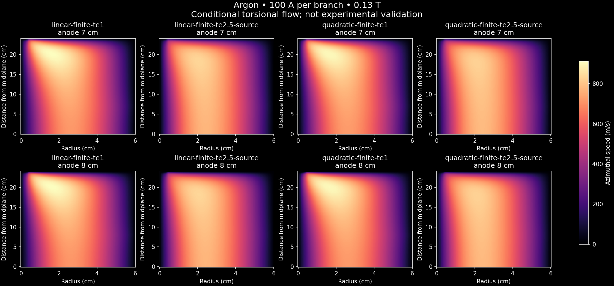

# Non-rigid argon flow

Implemented an independent steady spatial current/rotation reference using
[scikit-fem](https://scikit-fem.readthedocs.io/) Q2 elements and SciPy sparse
solvers. Rotation varies with radius and axial position; resolved viscous shear
supplies wall braking. This is an offline conditional angular model, not a
replacement for the live transient model or experimental qualification.

The rigid model cannot reproduce the measured profile's turnover. Technically,
one neutral Omega forces centroid speed proportional to sightline offset; in
plain terms, the whole gas cannot spin like one solid object. The new reference
solves charge conservation and viscous angular momentum together, independently
of the retained finite-volume code. It uses the same physical inputs, rather
than adjusting drag or velocity to improve agreement. This tests the numerical
implementation while avoiding invented density and thermal boundaries.

Matched to [Wijnakker's argon apparatus](https://doi.org/10.1051/jphyscol:19797236):
6 cm radius, 24 cm half-length, 0.13 T and prescribed 100 A per branch. Both
7/8 cm anode interpretations and all four source transport alternatives remain.
The historical uniform viscosity is 1.14e-4 Pa s. The 4 mm cathode source is an
ideal mathematical ring; its aperture is not a measured emission footprint.
The 1 Torr fill behind cathodes is not an assumed uniform discharge pressure.

All 24 cases (eight alternatives, three nested meshes) passed unchanged screens:

| Quantity | Largest difference/residual |
| --- | ---: |
| Finest FEM versus independent FV(n8) uniform-emissivity chords | 0.0461% |
| Final chord refinement change | 0.000489% |
| Final local midplane speed change | 0.00588% |
| Final viscous work change | 0.0129% |
| Final common-grid peak-normalized angular field change | 4.8152% |
| Charge / torque / work residual | 1.89e-11 / 9.39e-12 / 1.74e-12 |

These are numerical comparisons, not pointwise error bars or experimental
accuracy. The angular field is least resolved near ideal current contacts.
Contact potential and Joule heating are singular in this ring idealization;
exact work balance does not make their continuum values physical. Meridional
momentum/continuity/energy and the actual optical estimator remain unresolved.

Native OpenFOAM 14 alternatives were also tested at unchanged resolution and
tolerances. Baseline, coupled-vector velocity and diagonal pressure variants
failed rigid-motion controls; GAMG diverged and was stopped after 245 seconds.
Final pressure convergence alone did not prevent spurious motion. No native
solver variant was adopted; the full transient backend remains unqualified.

Bulk field sampling initially stopped before the finest result. Element lookup
allocates temporaries proportional to points times elements; a large output
request can overwhelm memory. Sampling in 128-point batches preserves the same
equations, coordinates and resolution, unlike reducing the mesh. A direct-versus-
batched regression passes. Both incomplete and completed snapshots are retained.

The independent audit also caught roundoff in wall interpolation: constrained
coefficients are exactly zero, but inverse mapping returns 0.9999999999999973
instead of 1. No fields were clamped. The audit uses a documented floating-point
consistency check; its original arbitrary absolute assertion is retained. The
1e-8 conservation and 5% refinement/reference gates are unchanged.

See [protocol](scientific/nonrigid-v98/PROTOCOL.md) and
[independent physics review](scientific/nonrigid-v98/PHYSICS-REVIEW.md).
Producer snapshot: `ea632a72790d7c5d879441399d1cd3ddbc66d03c1b5a8b08b3b0c87d8c8cbd7d`.

Independent packet replay passed216 checks; six physics, three native-admission
and eight evidence-corruption tests passed. Final `npm run typecheck`,
`npm run build`, `npm run check:site` and `npm run check:assets` all exited0
inside safe-dev after verifying326 unchanged application input hashes.
Auditor snapshot: `75167bf221a2df87c06c7633ae2be5b4894099c38d563412208c205df4e4287e`.

