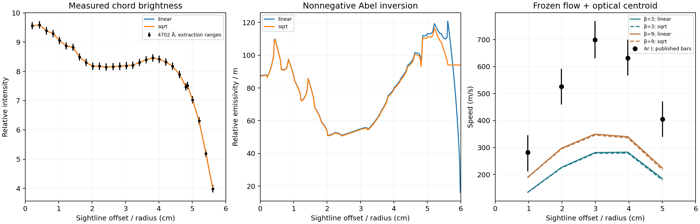

# Optical diagnostic follow-up

11 November 2026. **The optical follow-up does not close the measured rotation
gap.** This stage tests the mapping of frozen V79 flow fields to observed light;
it does not qualify the playground experimentally. No measured-speed fit was made.

## What the source establishes

The [1979 experiment](https://doi.org/10.1515/zna-1979-0602) uses a pressure-scanned
Fabry–Perot interferometer to measure ion/neutral Doppler shifts. It suppresses
Zeeman broadening with a polarization filter. The spectral estimator, response
function, free spectral range, finesse and effective aperture are not supplied.

Figure 6a measures neutral 4702 Å and ion 4806 Å line intensities with a separate
monochromator at the matched diffuse-discharge condition. These are projected
brightness profiles; no Abel inversion was applied. The velocity measurement's
neutral wavelength is not explicitly identified, and “line intensity” is not
defined as integrated area rather than peak height or a selected channel.
Consequently using this brightness as velocity-line photon weighting requires
**same-line and integrated-photon-brightness assumptions**.

The central temperature is inferred from the ion 4806 Å linewidth; the outer
temperature uses a corrected thermocouple. Neither supplies an independently
measured local neutral temperature map. Optical depth also remains unknown;
total neutral density does not determine the absorbing excited-state population.

## Root cause addressed and method

V79 assumes uniform local emissivity and compares a spectral centroid with the
reported Doppler shift. Those choices were explicit but unsupported diagnostic
inputs. They may contribute to the mismatch; they are not its established
physical cause. A flat projected brightness does not imply uniform emission
inside the vessel: different sightlines traverse different path lengths.

The smallest coherent correction is an explicit optical forward model, with
brightness conditioning separated from velocity scoring:

- Independently digitize the neutral brightness symbols and preserve source/crop
  hashes, calibration, extraction ranges and exclusions.
- Use [PyAbel](https://pyabel.readthedocs.io/en/latest/abel.html)'s nonnegative
  degree-zero Daun inversion, conditioned only on brightness. Retain both
  declared outer-edge continuations; neither is selected by velocity agreement.
- Generate isolated-line Maxwellian spectra by exact Gaussian-bin integration
  with SciPy, following the documented
  [CHERAB algorithm](https://www.cherab.info/models/line_shapes/spectral_line_shapes.html).
  This adapts the algorithm; it does not execute CHERAB/Raysect or recover an
  unmeasured Fabry–Perot transfer function. Report centroid and mode separately.
- Independently bound centroids over all nonnegative annular emissivities on
  each tested mesh consistent with the original brightness intervals using
  [SciPy/HiGHS](https://docs.scipy.org/doc/scipy/reference/generated/scipy.optimize.linprog.html).
  The Charnes–Cooper transformation turns each ratio into a linear program.
  Recovered emissivity certificates must satisfy the original constraints and
  independently recomputed centroid; solver failure is explicitly unavailable.

Using established inversion/optimization tools avoids inventing an emissivity
law from unmeasured plasma populations. Keeping all admissible brightness
profiles also exposes reconstruction ambiguity rather than selecting smoothing
or an outer continuation that makes the velocities look better.

## Limits and checks

The linear-program bounds are conditional on the supplied fixed geometry/path
matrix and brightness intervals. They do not automatically cover uncertain
sightline positions, background subtraction, opacity or the same-line ambiguity.
Different target extrema may require different emissivity profiles; their
envelope is not one predicted velocity curve.

Positive emissivity constrains full-line centroids to the local projected-speed
range. Gaussian-mixture modes obey the same necessary bound, independent of
positive thermal widths. This does not certify an arbitrary fitted estimator,
clipped window, absorption or Fabry–Perot order assignment. Passing a necessary
bound does not prove that one common brightness-compatible profile fits all
measured shifts.

Temperature and centered instrument-width variations are declared sensitivities,
not calibrated uncertainty bounds. All β cases, voltage alternatives, optical
estimators, edge closures and convergence failures must remain visible. Optical
mesh/bin refinement, brightness reprojection, flux/moment conservation, analytic
controls and target-mutation independence are specified in the
[protocol](scientific/optical-v80/PROTOCOL.md).

**No new velocity fit is permitted.** The V79 packet remains byte-identical,
including viscosity, conductivity, current, geometry and flow predictions. Its
measured velocities were already seen before this follow-up, so this is a
diagnostic investigation of development data, not prospective validation.
The existing 20% criterion and extraction masks remain unchanged.

## Results and verification

The original journal PDF was recovered through the publisher's normal download.
An independent agent extracted **29 neutral open-circle brightness symbols**;
one axis-overlapping symbol was excluded solely for resolvability. The two
overlapping circles near 4.8 cm were retained after inspecting a higher-resolution
crop. Center and axis uncertainties of ±4 pixels are extraction ranges, not
experimental noise estimates. Source and extraction hashes are retained in
[the input record](scientific/optical-v80/brightness-independent.json).

At the nominal electrical condition, the unchanged five measured speeds are
approximately **282, 526, 699, 632, 405 m/s**. Brightness-conditioned centroids are:

| Frozen flow | Edge continuation | Predicted speeds (m/s) | Worst relative error |
|---|---|---|---|
| β = 3 | Linear | 135, 227, 282, 283, 184 | 59.7% |
| β = 3 | Square root | 134, 225, 279, 279, 179 | 60.2% |
| β = 9 | Linear | 190, 298, 350, 340, 224 | 50.0% |
| β = 9 | Square root | 189, 295, 346, 336, 217 | 50.5% |

The conditioning generally lowers the maximum of the radial centroid profile rather than
repairing V79's underprediction. Absolute brightness scale cancels. The local
reconstruction has structure amplified by Abel differentiation; its fine detail
is not an experimentally recovered plasma-population map.

The full campaign retains both β cases, all three electrical-voltage alternatives,
both outer continuations, six prescribed temperature cases, three centered
instrument widths, and both centroid and mode: **432 scored alternatives**.
None passes the unchanged 20% test, either for all points or for V79's existing
extraction-eligible points. Temperature/response variations are sensitivities,
not inferred instrument or neutral-temperature parameters.

The brightness-constrained LP envelope is substantially broader than either
chosen reconstruction. At nominal β = 9, its finest-mesh upper centroids are
approximately **309, 527, 557, 505, 285 m/s**. The middle two fall only just below
the nominal 20% thresholds: **this is not a robust exclusion** once velocity
extraction ranges, radius uncertainty and finite-basis limits are considered.
These bounds apply to centroids, not to modes with varying thermal widths, and
different extrema can require different emissivities. The separate positive-kernel
hull test covers both centroids and modes under its stated assumptions.

### Numerical corrections and independent checks

Independent review caught a common-mesh endpoint bug before scoring: two
nominally identical wall radii could differ by floating-point roundoff, creating
a spurious extra annulus. In plain terms, the two grids disagreed about exactly
where the wall was. The mesh now assigns the known wall radius exactly, observers
require matching domains, and the LP moment reuses the validated observer.
This preserves the physical boundary instead of silently clipping or extrapolating
a sliver. A one-ULP mismatch regression verifies rejection.

Review also found that centroid refinement cannot validate the prescribed
temperature-gradient spectrum, because a full-line centroid is independent of
thermal width. Mode and variance are therefore checked between 128 and 256 optical
samples as well as across spectral-bin widths. This additional gate was recorded
before scoring; no physical input or acceptance threshold was tuned to velocities.

The independent results audit reports **all final numerical gates passed**:

| Numerical check | Maximum reported change / error |
|---|---|
| Centroid optical refinement, including 64→128 | 0.0872% |
| Mode, spectral-bin refinement, including 10→5 m/s | 0.00200% |
| Mode, 128→256 optical samples | 0.0276% |
| Variance, 128→256 optical samples | 0.0179% |
| Photon-flux error | 1.54 × 10⁻¹³ |
| Projected-speed hull violation | 0 m/s |
| Recovered LP brightness residual / intensity scale | 1.51 × 10⁻¹⁴ |

All brightness-constrained LPs returned finite primal certificates; the audit
checks their saved residuals, not independently solved dual optimality. Maximum
brightness reprojection residual across all meshes is 0.893% of the brightness
scale. No velocity agreement follows from these numerical checks.

Executed offline in the Apple VM:

- `python -m unittest discover -s scientific/optical-v80 -p 'test_*.py' -v`:
  **27 passed**, including Gaussian-bin variance, the independently implemented
  V71 moment observer, shared-boundary regression and measured-target mutation.
- The same discovery commands for `scientific/diagnostic-v71` and
  `scientific/profile-v79`: **11 and 16 passed**.
- Optical prediction, separate comparison, independent necessary-bound and
  independent numerical-audit commands: **exit 0**.
- `npm run test`: **1,238 passed, 0 failed**.
- `npm run typecheck` and `npm run build`: **passed**.

The [execution receipt](scientific/optical-v80/results/verification.json) records
all command arguments, logs, package versions and every tested source hash.
The tested 1,713-file source snapshot hashes to
`1ebe6d0e0ad8ed9fb58bc979e1fdcc810957d129078b5000586b5170f08483d1`;
this report's final numerical summary was added afterward. The frozen V79
prediction SHA remains
`1a1e7e54974ed7e7e28be655e911b17d3cdd7bc55107b34474148702858ef128`.
No production simulator code or README changed.

### Reproduce

All execution uses Apple VMs through `safe-dev`, with explicitly synchronized
source copies. Install the pinned
[scientific dependencies](scientific/optical-v80/requirements.txt) inside the guest.
Then run `study.py`, `compare.py`, `independent_bound.py` and `audit.py` in
`scientific/optical-v80`; command arguments and exact source hashes are retained
with the final verification receipt. `study.py` does not read measured-speed targets;
the scoring entry point is separate. A mutation control changes the actual
co-located measured-speed file and requires byte-identical prediction output.

### Remaining barrier

This removes an unsupported uniform-emission assumption; it does not establish
the physical cause of the residual. A calibrated neutral-line identity, brightness
response and Fabry–Perot reduction/transfer function would make the optical test
decisive. In parallel, the frozen flow still prescribes homogeneous transport
properties and excludes meridional circulation. Those assumptions remain plausible
physical sources of discrepancy, not explanations proved by this study.
