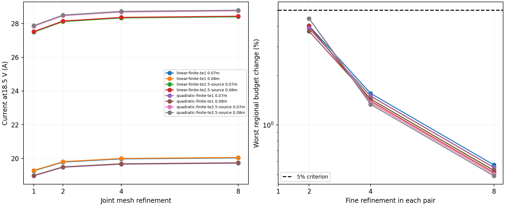

# Fixed physical regions and electrode-edge refinement

12 November 2026. This study resolves the regional numerical failures for eight
predeclared source-transport cases. It does **not** resolve the experimental
100 A current discrepancy or establish experimental accuracy.

## Problem and root causes

V82 retained 72 final regional-budget failures. Twenty were anode-band Joule
budgets on fixed intervals: globally converged current did not imply convergence
of this smaller, edge-sensitive contribution. The likely numerical difficulty
was the mixed electrode/insulator edge, where current gradients become steep.
Fifty-two near-endwall budget failures mixed discretization with moving domains:
selecting cells by their centers changed the physical integration boundary.
The nominal access-depth cut also depended on the first radial cell's transport.

In simple terms, some comparisons summed different slices of the machine, while
the anode slice needed finer resolution. No error was found in the half-face
Joule/work accounting itself.

## Fix and alternatives

The new nested meshes contain every diagnostic cut as an exact face. Access depth
is frozen from the continuous-axis transport before any refinement. Cosine grading
places more cells near cathode and anode edges; all four joint refinements retain
the same physical integration domains. Whole-cell sums preserve the discrete
electrical identity without inventing an off-grid potential or heat distribution.

This was chosen over fractional cell interpolation, which would remove moving
masks but would not resolve anode-edge gradients or supply the electrical flux
through an unmodeled cut. No contact radius, conductivity gain, voltage offset or
velocity target was adjusted. All original 5% and 1e-8 gates remain unchanged.

The primary and reference are isolated instances of the frozen V81 equations.
Only their mesh generators are replaced, with strict checks on requested physical
breakpoints. The reference retains independently assembled velocity equations
and arithmetic radial centers, but shares the mesh selection. We compare common
sightlines, currents and powers; point values at different centers are not equated.

## Scope and result

The frozen scope is four finite-neutral-fraction source transports—linear and
quadratic shapes, each at 1 eV and source-partition 2.5 eV—and both anode-center
interpretations, ±7 and ±8 cm. All use 18.5 V and source conductivity, without
current conditioning. Refinements are 1, 2, 4 and 8. Two directional controls
hold one direction at refinement 4 against the 8/8 baseline for the declared
linear-1 eV, ±7 cm case. This is 34 primary and 34 independent solves.

Every final regional Joule/current and rotor-work/current change is below 0.572%,
versus the original 5% criterion. This qualifies these eight cases on the new
fixed-domain meshes, not the omitted V82 collision-partition controls. The old
V82 failures and their original definitions remain preserved.

| Source transport | Current at 18.5 V, centers ±7 / ±8 cm |
|---|---:|
| Linear, finite neutral fraction, 1 eV |20.032 /20.058 A|
| Quadratic, finite neutral fraction, 1 eV |19.717 /19.743 A|
| Linear, source collision partition, 2.5 eV |28.396 /28.434 A|
| Quadratic, source collision partition, 2.5 eV |28.750 /28.789 A|

Thus improved resolution leaves a large current deficit. Numerical regional
convergence cannot substitute for the missing cathode/contact and voltage inputs.
Regional power/current remains a volt-equivalent work budget, not a measured
local potential drop. No new optical or experimental velocity qualification is
claimed in this numerical study.

## Independent source review

The [boundary-source review](scientific/regional-v83/BOUNDARY-SOURCES.md) checked
the original study, institutional thesis records and the complete rehosted body
of the [1980 follow-up](https://www.researchgate.net/publication/253120741_Limitations_on_Mass_Separation_by_the_Weakly_Ionized_Plasma_Centrifuge).
That follow-up specifies different tungsten cathodes and normalizes a velocity
scaling comparison to a measured argon point. Neither transfers an independently
known current footprint to the 1979 hollow-tantalum apparatus nor provides an
absolute-amplitude validation. Its OCR equations and figures were not visually
verified. The dissertation's full text was not recovered from its institutional
record; this is an access limitation, not proof that the required data do not exist.

No independently specified finite-contact voltage operator or axial transport
map was recovered. A prescribed-current ideal-ring theory reproduction remains
a separate mathematical benchmark, not a justified fix to the absolute-voltage
experiment. Production physics, the live playground and README remain unchanged.

## Reproduction

The [protocol](scientific/regional-v83/PROTOCOL.md) was committed before new
predictions. Prediction SHA256:
`a9cc96d31bf42f7039700dc5fae01f94ecaf12b98752c4dcf8c012fad39d3676`.
All scientific execution used the existing offline safe-dev VM, explicitly synced
from the 463.8 MiB staged copy. Old stage field copies were archived after byte
comparison; original results and pre-replacement guest exports were preserved.
The unsuccessful publisher download was a scoped online attempt, not a scientific
result. The source reviewer used the rehosted article body instead.

## Verification

The independent saved-array auditor reports 34 cases, no failures, maximum final
common-observable change 0.584%, maximum final regional change 0.572%, and
maximum electrical-budget identity residual 7.23e-11. All 128 final regional
comparisons pass. This auditor checks saved arrays, seals, geometry and ledgers;
it does not independently reassemble the PDE. The separate reference solves
provide the independently assembled flow comparison on the shared graded mesh.

For the single declared directional-control case, radial coarsening changes the
anode Joule/current budget by 0.268%; axial coarsening changes it by 0.421%.
Both directions matter locally. These controls do not isolate the causal effect
of face alignment from edge grading, nor qualify directional sensitivity for
the other seven cases.

Executed offline in the synced VM, all passed:

- `python -m unittest test_mesh83 test_regions83 -v` — 6 tests.
- `python campaign83.py` — 34 primary and 34 reference solves.
- `python -m unittest test_audit83 -v` — 12 adversarial auditor tests.
- `python audit83.py results/predictions.json results/audit.json` — passed.
- `python summarize83.py` — sealed prediction unchanged.
- `npm test` — 1,238 tests passed, none failed or skipped.
- `npm run typecheck` and `npm run build` — passed.

The exact Python executable was
`/work/home/diagnostic-v72-venv/bin/python`; scientific commands used
`OPENBLAS_NUM_THREADS=1 OMP_NUM_THREADS=1`.
[Prediction receipt](scientific/regional-v83/results/execution-predict.json),
[final receipt](scientific/regional-v83/results/execution-final.json),
[audit](scientific/regional-v83/results/audit.json), and
[summary](scientific/regional-v83/results/summary.json) retain commands, source
hashes and results. Raw command logs and compressed field packets are included.

Final review also found that the auditor's command-line entry point wrote failed
gates but still exited successfully. An automated runner could therefore mistake
a completed audit for an accepted result. It now retains the report and returns
nonzero if any required final gate fails. A regression covers each failure and
success. This minimal exit-status fix preserves diagnostics and thresholds;
throwing away the failed report would make investigation harder. The actual
V83 numerical results were already passing and remain unchanged.
