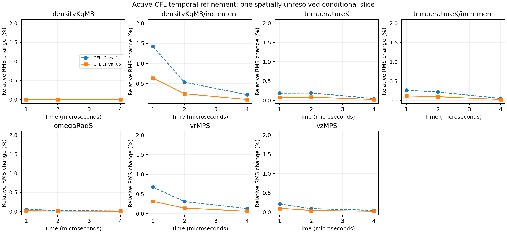

# Active-CFL time refinement

12 November 2026. **The prospective temporal screen passes for one fixed-grid
conditional case. Experimental and full-model qualification remain false.**

## Problem, cause and fix

The V86 maximum-step study took 654/654/655 steps; its first two trajectories
were identical. Technically, the acoustic CFL bound controlled almost every
`min(cap, remaining, acoustic)` decision. Simply, reducing an inactive cap did
not meaningfully reduce the actual timesteps.

V87 halves the active acoustic CFL instead, keeping the same 64x96 mesh,
`linear-finite-te1` scenario, 0.07 m anode, physical coefficients, initial state,
hydro/Hall/stress/conduction ordering, and 0/1/2/4 microsecond reporting times.
This is the smallest causal experiment: changing the integrator or physical
closure simultaneously would obscure the timestep diagnosis. No measured
velocity was read, scored or fitted by this campaign.

## Results

| Acoustic CFL | Accepted steps | Largest accepted step | Acoustically limited nonterminal steps |
|---|---:|---:|---:|
| 0.2 | 654 | 47.667 ns | 651/651 |
| 0.1 | 1,310 | 23.833 ns | 1,307/1,307 |
| 0.05 | 2,621 | 11.917 ns | 2,618/2,618 |

- **28/28 temporal field gates pass**, including density/temperature increments.
  The largest finest-pair relative RMS change is **0.63954%**, density increment
  at 1 microsecond; the preceding change was 1.42445%. All gates meet the
  declared contraction/zero-change rule and unchanged 2% limit.
- **112/112 exact-panel quadrature checks pass** at orders 2/3/4. Relative
  comparisons use the declared physical norms, with no fitted floor.
- The CFL 0.2 field/history packet reproduces V86 **byte for byte**, raw and
  compressed, in the retained environment. The independent auditor also checks
  decoded equality and reconstructs acoustic bounds at saved pre-step states.
- Conservation, positive internal energy, species bounds, EOS reconstruction
  and electrical-work accounting pass. Intermediate unsaved PDE rows and CFL
  candidates remain producer evidence, not independent full-step replay.

These are changes between finite-step solutions, not a bound on exact-PDE or
laboratory error. The initial-time gates are reproduction controls. The
three runs retain frozen transport and one-heavy-temperature heating; they
are not a new discharge thermal model or an optical measurement comparison.

The **64 V86 spatial failures remain unresolved**. Its complete original failed
audit and post hoc panel supplement remain unchanged, including the ineffective
old cap comparison. Missing electron/ionization/radiation/wall closure and the
existing experimental mismatch are not repaired by this temporal result.

## Adversarial review fixes

An initial synthetic cap-limited control exposed duplicate checkpoint counting
in the new auditor. Approximate time matching identified both a tiny residual
step just before a reporting event and the event itself. Exact checkpoint
identity fixes this; CFL, conservation and convergence tolerances are unchanged.
An explicit residual-step regression passes. [The failed attempt, logs and old
checker sources](scientific/timestep-v87/results/failure01/README.md) are retained.

Other reviewer fixes retain unresolved relative comparisons in plots/counts,
verify the exact admitted panel bytes used for old failure counts, and prevent
normal replay from overwriting complete or partial evidence. Use the
[canonical launcher](scientific/timestep-v87/REPLAY.md); the executed producer
remains frozen. These correct the actual reporting/output boundaries without
forcing an unchanged physical replay for checker-only edits.

## Exact checks and evidence

All project execution used the offline safe-dev VM. The final tested source
copy contained **2,652 files / 508,809,701 bytes**, snapshot
`39681522d563565c6194078927d115642bfc042976fd575baf41b840631cc39b`,
guest `safe-dev-0b0443eadcbe4bd8`. The physical producer was sealed before
prediction; its nine source hashes and package versions are in the prediction.
Checker/report sources, commands, runtime versions, logs and artifact hashes
are separately recorded in the [final receipt](scientific/timestep-v87/results/execution-final.json).
Report prose was completed after execution; scientific source seals were not
changed. The application build is preserved separately in the guest.

| Check | Result |
|---|---|
| Study, reporting and replay controls | 9 passed |
| Independent active-CFL controls | 11 passed |
| Report-admission stale-input controls | 10 passed |
| Actual V86 report-input admission | Passed; no qualification promotion |
| Independent temporal audit and summary | Both exit 0; full-model qualification false |
| Frozen V86 main/independent controls | 48 / 24 passed |
| Reused hydro / stationary-wall torque controls | 12 / 3 passed |
| `npm test` | 1,238 passed |
| `npm run typecheck`; `npm run build` | Both passed |

The production command ran `study87.py` in the recorded isolated Python
environment after its four original driver controls. Subsequent checks did
not rerun physical trajectories. The new canonical fresh-run entry point is
`python scientific/timestep-v87/launch87.py`; exact check commands are in the
receipt above. Python/zlib versions matter for compressed-byte identity;
raw-state equality is the numerical reproduction control.

Prediction SHA256:
`4a3a4fcd7801480c9590828b7949d4fd7cf47289bf4dca183e46f8fd1a57b2e1`.
Frozen V86 prediction SHA256 remains
`70e0923e8ac9a53a476e439a9df3e670fb52467ee9d3d6ab5aa62ad9eae5e5c7`.
See the [audit](scientific/timestep-v87/results/audit.json),
[summary](scientific/timestep-v87/results/summary.json),
[prospective protocol](scientific/timestep-v87/PROTOCOL.md),
[prospective independent review](scientific/timestep-v87-independent/PROTOCOL-REVIEW.md),
and [final evidence review](scientific/timestep-v87-independent/FINAL-REVIEW.md).

Next: use the installed OpenFOAM reference for a separately specified
laminar monatomic-Ar swirl/stress-energy control, then address the unresolved
spatial/physical closure rather than developing another custom CFD framework.
The [tooling review](TOOLING-REVIEW-V87.md) distinguishes actual code reuse,
the completed installation smoke, and prospective migrations.
