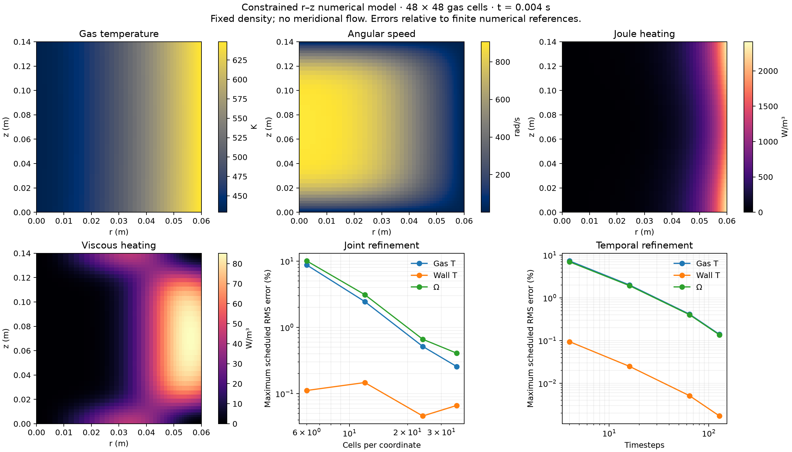

# Axial shear, electrical current and heat — v74

Research backend: full axial/radial rotation and gas/tungsten temperature.
This is numerical verification of a bounded model, not experimental device
validation. The public playground has not been switched to this backend.

## What was missing

The earlier combined model repeated one radial rotation field over the axial
electrical mesh, then summed torque and Joule heat back into radial bins. The
v73 FiPy extension resolved axial rotation but did not evolve its local heat.
Consequently, axial braking could not change local temperature and transport
properties consistently. Averaging preserves total torque but generally changes
the torque work `sum(torque * angular_speed)`.

In plain terms, slices turning at different speeds were forced to share one
temperature/rotation profile. A drag multiplier cannot restore the information
lost in that projection.

## Coupled equations and implementation

For fixed prescribed density and zero radial/axial velocity:

```
rho r² dOmega/dt = (1/r) d(mu r³ dOmega/dr)/dr
                  + d(mu r² dOmega/dz)/dz + electrical torque density
Cgas dT/dt = conductive heat + local Joule heat + physical viscous heat
d(m hW(T))/dt = conductive heat
```

The actual existing TypeScript current solver receives the full accepted
`Omega(r,z)` array. Its matched motional-EMF and torque weights retain
`P_electrode = P_Joule + sum(torque_i * Omega_i)`. SciPy GMRES solves the
affine current/momentum endpoint using the actual FiPy torsional operator;
the final angular-speed and work discrepancies are checked explicitly.

FiPy cylindrical finite volumes evolve gas and tungsten heat in both r and z.
Gas heat capacity is `3/2 kB Ncell`, using ordinary cell volume, not the
torsional r²-weighted capacity. Tungsten storage uses sourced enthalpy, not
`cp(T) T`. Radial conduction uses logarithmic half-cell resistances; the
gas/solid film resistance appears once. Interface heat leaves one material
and enters the other. The curved exterior has a specified Robin reservoir;
thermal axial faces insulate independently of their mechanical condition.

The endpoint iteration updates sourced neutral-argon viscosity/conductivity,
tungsten conductivity/heat capacity/enthalpy, current, rotation and local
heating together. Constitutive domains are enforced without extrapolation:
argon 300–20000 K; tungsten 300–1900 K. Film coefficients and electrode settings
in the manifest are illustrative inputs, not inferred Marathon specifications.

The local viscous source reconstructs each actual FiPy face's dissipation.
An internal face's heat is split by its two fluid half-resistances, including
unequal viscosity and nonuniform cell sizes. No-slip endwall dissipation heats
the adjacent gas half-cell. A stationary wall can brake gas while doing zero
wall work; a moving wall supplies `Omega_wall * torque_wall_on_gas`.

Backward-Euler numerical damping remains a separately reported positive sink:

```
delta(K + Ugas + Htungsten) + Qreservoir + numerical_loss
    = electrode_work + moving_wall_work
```

It is never deposited as physical heat. Endpoint residuals also never become
corrective heat sources. This approach preserves the existing electrical and
constitutive implementations and adds the missing spatial degrees of freedom;
it avoids an independently invented current closure or an empirical drag fit.

## Failure found by the independent audit

The first full refinement attempt failed local momentum checks despite passing
global energy checks. A captured 24×24 endpoint had a weak-cell torque error
`1.4363e-18 Nm`, above its unchanged `1.8640e-19 Nm` local tolerance. Using
the exact torque supplied by the TypeScript solver reduced the independently
reconstructed momentum residual to `2.13e-25 Nm`. This isolated the cause:
the current solver's global residual target did not resolve that weak local
torque accurately enough; the viscous operator was not responsible.

In simple terms, the electrical solve was accurate for the circuit as a whole
but insufficiently accurate in a weakly driven cell. The smallest fix is an
optional stricter current tolerance. Existing callers keep 1e-11; the research
adapter initially requested 1e-14. Both the iterative residual and reconstructed true
residual use the requested target. The option cannot relax existing acceptance
or request precision below the admitted floating-point floor. The same failed
case is a regression test. No physical coefficient or convergence gate changed.

The 96×96 reference exposed the same conditioning problem in a near-axis cell:
the independent torque differed by `3.8103e-23 Nm`, above a `3.0907e-24 Nm`
local allowance. Substituting the actual supplied torque reduced the momentum
residual to `2.67e-27 Nm`. Replaying the identical first step at 1e-14, 4e-15
and 2e-15 failed; 1e-15 and four machine epsilons passed the unchanged local
checks. The research adapter now requests the admitted four-epsilon floor.
This measured precision headroom supports tightening the existing solver;
replacing its algorithm or relaxing a local equation check is not justified.

Additional corrected implementation defects: normalize scalar initial speeds
before the energy ledger; specify a floating SciPy operator dtype and encode
adapter scalars explicitly; import the sealed v73 torsion by its exact file
instead of changing global module lookup and shadowing the v74 checker.
Each has regression coverage. These are bounded fixes rather than fallbacks.

## A nonconvergent electrical boundary, not a transport coefficient error

The first verification setup imposed 4 V on the entire outer boundary and 0 V on
both end faces. Those differently biased surfaces meet at each corner without
an insulating gap. The resulting Dirichlet jump gives `E proportional to1/s`
near the corner and logarithmically infinite continuum Joule power. A finite
network can conserve energy exactly while approximating this divergent problem.

The retained fixed-256-step studies produced 2.485855, 3.444947, 4.437036, 5.441208 W
at 6, 12, 24, 48 cells per coordinate. The last refinement adds 1.004171 W, close to
the independently derived asymptotic 1.010 W per doubling on these boundary-
graded grids. This explains why passing global ledgers is insufficient.

In plain terms, the control put different voltages on touching surfaces with
no space between them. Refinement resolves ever larger artificial currents.
The corrected verification input is a smooth distributed outer potential
`4 sin(pi z/L)` that joins the grounded ends continuously. It has a known
finite-energy Bessel solution, checked separately before coupled runs. This
manufactured boundary tests the equations without inventing a physical gap
dimension or fitting an added resistance. It is not an equipotential metal
electrode. The old studies remain negative evidence; no tolerance was relaxed.

Repeated construction of identical FiPy geometry was also making refinement
expensive. A trajectory workspace now retains geometry and updates a
dependency-tracked viscosity variable at each thermal trial. Regression tests
compare low/high/restored viscosity, changed timesteps and successive states
with fresh stock torsion solves. No approximate matrix-factor cache or new
physical equation is introduced.

With the compatible boundary, study03 completed 19 trajectories but remained
unqualified: its 96×96 reference failed the weak-cell precision check, and the
24×24/64-step early transient missed interface heat and wall torques by 2–3%.
The tighter-tolerance repeats were stable, and 48×48/256 versus 512 steps
passed, isolating the latter discrepancy as time resolution rather than a
constitutive or endpoint-iteration error. Prospective study04 retains the old
levels and adds 36×36/144 steps to the joint series and 24×24/128 steps to the
timestep series. It does not change the physical inputs or acceptance limits.

Study04 then exposed a thermal line-search plateau at the tenth 96×96 step.
The near-axis gas row had a `4.4039e-17 W` residual against a `4.3468e-17 W`
inner tolerance. Its Newton correction was `2.7374e-14 K`, less than half a
floating-point temperature increment at 400 K: the proposed temperature could
not move. Storage roundoff alone does not cover conductive flux error, which
also inherits the representational error of both absolute temperatures.

The existing radial thermal solver already included this effect. The 2D
solver now adds the same 16-epsilon conductance/temperature allowance to its
inner residual test and reports it separately for every cell. All independent
local physical, global conservation and refinement gates remain unchanged.
This is an explicit arithmetic bound, never a heat source. A synthetic
sub-ULP heat dipole and the captured real 96-cell state provide regressions.
Bounding the unresolvable arithmetic preserves the physical error target;
increasing the relative tolerance would also admit larger resolvable errors.
Study05 repeats the same physical/refinement inputs with that correction.

## Verification and evidence

The [prospective protocol](../scientific/coupled-axial-v74/PROTOCOL.md) and
[manifest](../scientific/coupled-axial-v74/manifest.json) fix numerical inputs,
response-normalized local-field gates, torque/heat/current observables and
separate tolerance studies before execution. The independent NumPy/SciPy
checker imports no production solver; it rebuilds electrical, viscous and
thermal graphs and checks every accepted step during trajectory generation.
Scheduled endpoints retain raw fields; per-step audit receipts cover the
intermediate steps. Deliberately corrupted potentials, local heat, temperature,
numerical loss and reservoir heat must be rejected.

Retained preliminary/failed evidence is described in
[ATTEMPTS.md](../scientific/coupled-axial-v74/ATTEMPTS.md).

### Accepted study05

**All frozen numerical gates pass:** 22 trajectories, 3896 independently
checked steps, 66 saved endpoints independently rechecked after execution,
and all six deliberately corrupted endpoints rejected. No physical coefficient
was fitted. Experimental and live qualification flags remain false.

Worst scheduled errors at each series' finest tested level, against its
declared finite reference:

| Series | Gas T RMS | Tungsten T RMS | Angular-speed RMS | Worst torque/heat/current/peak observable |
| --- | ---: | ---: | ---: | ---: |
| Joint, 36×36 / 144 steps | 0.257% | 0.0662% | 0.408% | 0.762% |
| Spatial, 24×24 / 256 steps | 0.134% | 0.0408% | 0.345% | 0.335% |
| Temporal, 24×24 / 128 steps | 0.139% | 0.00172% | 0.136% | 0.898% |
| Radial, 24×48 / 256 steps | 0.133% | 0.0408% | 0.121% | 0.194% |
| Axial, 48×24 / 256 steps | 0.00214% | 0.00000357% | 0.308% | 0.158% |

These are the protocol's response-normalized errors, not percentages of the
absolute background temperature. Tungsten normalization is floored at 1 K.
Its joint RMS is nonmonotone, but every level is below the prospectively
allowed 0.2% exception. The worst local profile error across these final
comparisons is 1.656%, below 5%; all RMS and observable errors are below 2%.

The 48×48 reference compared with 96×96 differs by at most 0.0879% normalized
RMS, 0.305% local profile error and 0.0856% in the tracked observables. Halving
its timestep differs by at most 0.0702% RMS, 0.189% locally and 0.447% in
observables. Separate linear/thermal and combined tighter tolerances pass the
0.1% invariance gate; worst observable drift is below 6.5e-9 percent.
The largest independently reconstructed total-energy residual among the
66 saved endpoints is 2.94e-11 J; every intermediate step also passed its
exchange/storage-scaled checks during execution. The maximum across all 3896
per-step independent receipts is 4.67e-11 J.



The figure was inspected after export. It shows actual accepted 48×48 fields,
physical heating per volume and finite-reference errors; it is not a device
render or experimental comparison.

Evidence: [raw trajectories](../scientific/coupled-axial-v74/study-05.json),
[analytic current](../scientific/coupled-axial-v74/static-current-05.json),
[independent audit](../scientific/coupled-axial-v74/independent-05.json),
[convergence](../scientific/coupled-axial-v74/convergence-05.json),
[artifact/source receipt](../scientific/coupled-axial-v74/receipt-05.json),
[compact numerical summary](../scientific/coupled-axial-v74/summary-05.json).

The corrected study05 uses the isolated safe-dev source snapshot
`f85feba6adf8e0414e9cebbb0ee39cdec39c35c63ac79f7164341eb5712fe94a`
(1604 files, 229633176 bytes). Before its trajectory run, all 61 Python
controls passed in 17.138 seconds, including both captured fine-grid failures,
independent axial/radial heat references, moving-wall work and source/artifact
admission regressions. The five-mesh Bessel control passed with finest
potential RMS error 0.005536% and power error 0.018088%.

These checks ran offline in the VM with FiPy 4.0.3, NumPy 2.4.6, SciPy 1.17.1
and Matplotlib 3.11.2. Dependency installation alone used online mode. The
source is copied into the VM, with no host mounts or credential forwarding.
The full pre-run snapshot digest and the receipt's post-run dependency digest
list have different scopes: the latter is not a per-dependency pre-run seal.
Unused producer summary fields do not acquire independent verification merely
because the primitive fields and required ledgers pass.

Final exact checks, on that unchanged code snapshot:

```
/work/home/diagnostic-v72-venv/bin/python -m unittest discover -s scientific/coupled-axial-v74 -p 'test_*.py' -v
/work/home/diagnostic-v72-venv/bin/python scientific/coupled-axial-v74/static_current.py --output scientific/coupled-axial-v74/static-current-05.json
/work/home/diagnostic-v72-venv/bin/python scientific/coupled-axial-v74/run_report.py --output scientific/coupled-axial-v74/study-05.json
/work/home/diagnostic-v72-venv/bin/python scientific/coupled-axial-v74/independent_check.py scientific/coupled-axial-v74/study-05.json scientific/coupled-axial-v74/independent-05.json
/work/home/diagnostic-v72-venv/bin/python scientific/coupled-axial-v74/analyze.py scientific/coupled-axial-v74/convergence-05.json scientific/coupled-axial-v74/study-05.json --static scientific/coupled-axial-v74/static-current-05.json
/work/home/diagnostic-v72-venv/bin/python scientific/coupled-axial-v74/verify_results.py --raw scientific/coupled-axial-v74/study-05.json --static scientific/coupled-axial-v74/static-current-05.json --independent scientific/coupled-axial-v74/independent-05.json --convergence scientific/coupled-axial-v74/convergence-05.json --output scientific/coupled-axial-v74/receipt-05.json
/work/home/diagnostic-v72-venv/bin/python scientific/coupled-axial-v74/plot.py scientific/coupled-axial-v74/study-05.json scientific/coupled-axial-v74/convergence-05.json scientific/coupled-axial-v74/verification-05.png
node_modules/.bin/tsx --test tests/fuel-current-precision-v74.test.ts tests/fuel-current-v66.test.ts tests/fuel-current-axis-v66.test.ts tests/fuel-current-reuse-v68.test.ts tests/fuel-spatial-operation-v66.test.ts
npm run typecheck
npm run build
npm run check:site
npm run check:assets
```

Results: 61 Python controls and 15 targeted TypeScript tests pass; all listed
programs/checks exit zero. The existing large JavaScript chunk warning remains.
Site checks establish resource/module integrity, not browser/GPU execution.
The export was byte-compared with the host for all kernels, manifest and seven
accepted artifacts. The existing README and sealed v73/property sources are
unchanged. Publication is split into kernel, independent-audit and evidence
commits, each with fewer than 700 lines of non-test code.

## Physical limitations

Density and species inventories are frozen. There is no meridional circulation,
pressure-balance solve, compression work, separation-induced mass transport,
evolving ionization, Hall force, discharge sustainment or electron-energy
equation. All Joule heat enters one heavy-gas temperature immediately, an
assumed local thermalization closure. Electrical conductivity is prescribed.
Spatial heating at fixed density need not satisfy the omitted force equations.
Mechanical no-slip does not establish thermal accommodation. Endwall thermal
mass/material is not invented: the current axial thermal boundary is adiabatic.

The previous experimental velocity/field-scaling failures remain unresolved.
Passing this numerical study cannot establish experimental first-order accuracy
or validate a particular Marathon centrifuge operating point.

Independent reviews: [physics](reviews/v74-physics.md),
[final evidence](reviews/v74-independent-final.md),
[thermal design](reviews/v74-thermal-design.md).

Primary numerical bases: [FiPy4.0.3](https://pages.nist.gov/fipy/en/stable/),
[FiPy harmonic face implementation](https://raw.githubusercontent.com/usnistgov/fipy/4.0.3/fipy/variables/harmonicCellToFaceVariable.py).
The existing source files document the Mutation++ argon collision table,
NIST tungsten heat capacity and Tolias tungsten conductivity provenance.
