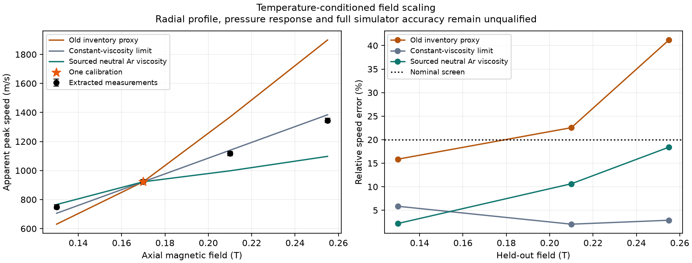

# First-order accuracy: experimental field scaling

10 November2026. **The complete simulator is not yet experimentally qualified
to first order.** This stage improves a failed benchmark hypothesis and identifies
which missing inputs prevent a defensible accuracy claim. No production source,
interactive default or deployed site changed.

## Root cause and correction

The v64 path `compare.ts → rotorResponse` scales all inertia and drag coefficients
with a filling-pressure/inverse-optical-temperature inventory proxy. At fixed
pressure its normalized field response is `V/V0=(B/B0)(Tapp/Tapp0)`.
Technically this holds the rate matrix fixed and changes forcing per inventory;
it does not represent steady viscous resistance. In plain terms, it lets hotter
gas accelerate more easily without increasing its resistance to shear.

The [original experiment, §4.1](https://www.degruyterbrill.com/document/doi/10.1515/zna-1980-0815/pdf)
instead motivates `Vmax ∝ IB/μ`. The new scientific harness tests
`V/V0=(B/B0) μ(Tproxy0)/μ(Tproxy)` using the existing sourced neutral-Ar transport
implementation. It preserves the old hypothesis and the constant-viscosity
limit as explicit comparators. This is preferable to fitting a new drag law:
there is one existing calibration point, no fitted transport exponent and no
parameter fitted separately at a held-out field. It is a correction to a
benchmark's physical assumption, not a demonstrated bug in `rotorResponse`.

The temperature input is the **apparent central optical temperature**, not a
measured radial field or mean gas temperature. Neither the old nor the new
scalar hypothesis predicts it. The source's estimated central-temperature bias
motivates a separate common1/.7 sensitivity, not a measured correction.
The [Mutation++v1.0.5 source](https://raw.githubusercontent.com/mutationpp/Mutationpp/v1.0.5/data/transport/collisions.xml)
confirms the Ar–Ar Q22 table, its π multiplier and accuracy="5" annotation.
Unknown confidence/correlation semantics remain unknown.

## Executed comparison

Frozen corrected reproduction markers at .13,.17,.21,.255T, all100A/3Torr;
one speed calibration at .17T, the other three fields held out. These are
published reproduced markers, not recovered raw instrument measurements.
The protocol predates execution; its source-accuracy extension preceded the
final run. Nominal error is relative to each measured speed, not an RMS divided
by a larger profile peak.

| Hypothesis | Worst held-out speed error | Nominal20% screen |
|---|---:|---|
| Old fixed-rate inventory proxy |41.1778%|Fail|
| Constant-viscosity limit |5.8501%|Pass|
| Sourced neutral viscosity at central-temperature proxy |18.4030%|Pass|

All three nominal curves increase with field. The neutral-viscosity errors at
the three held-out fields are2.1945%,10.6344%,18.4030%; with the common1/.7
temperature multiplier, its worst error becomes19.5047%.

The constant-viscosity comparator performs best. **Inference:** this sweep rejects
the extra positive thermal feedback in the old inventory proxy, but does not
identify the effective spatial viscosity from central optical temperature.
Radial temperature/current structure, shear weighting and optical response can
all affect that interpretation. Temperature-dependent transport is physically
necessary in its applicable domain; this test does not prove that substituting
one central temperature into it is an accurate spatial closure.



## Uncertainty prevents a complete pass

Each of six candidate/scenario records independently enumerates4096 extraction
corners and256 independent ±15% speed/temperature-coordinate corners. The two
neutral-viscosity scenarios additionally enumerate16 independent ±5% Q22 corners.
These are separate finite sensitivity sets, not continuous extrema, joint
uncertainty envelopes, standard deviations or confidence intervals.

- Nominal neutral-viscosity maximum-error sensitivity spans14.2305–22.3875%
  over extraction corners, and9.8138–26.1741% over Q22 corners.
- Independent reproducibility coordinates can raise that maximum to72.4560%.
  The source does not supply covariance; this is not a measured probability.
- At the common1/.7 temperature multiplier,128/256 reproducibility corners
  exceed the neutral-Ar table's20000K upper limit. They remain unavailable and
  prevent an all-corners pass. No property extrapolation fills them in.
- A common speed calibration factor cancels from normalized predictions.
  Independent coordinate perturbations pose a different question.

The old v65 profile failure remains39.98% RMS/observed peak, with all five outer
holdouts underpredicted. At fixed viscosity/current its steady pressure ratio
remains1 rather than the reported approximate2/3, a50% relative ratio error.
Those retained results were inspected, not rerun in this stage. New field passes
do not erase them or qualify enrichment, throughput, heating or extraction.

## Source recovery and limits

Two reviewers independently recovered the original1980 publisher PDF through
the web tool. It identifies the midplane apparatus and optical methods, but
does not supply a resolved radial temperature/current map for the3-Torr profile.
It also reports nearly constant central temperature across the pressure sweep;
using central-temperature viscosity alone therefore cannot account for the
measured slowdown. A unique missing mechanism has not been identified.

The original1979 low-field1-Torr study is a stronger matched-profile lead.
Its large indexed PDF exceeded the web parser limit, and two scoped guest
downloads returned zero bytes; they were not accepted as source documents.
Official alternative searches supplied metadata, not an admitted full dataset.
Its temperatures cannot be substituted into the separate3-Torr comparison.
No author was contacted and no access restriction was bypassed.

For predictive first-order qualification, the next admitted case needs the
same-condition radial temperature constraints, electrode/current boundary model
and actual spectral reduction. Then solve and compare the corresponding spatial
model with its diagnostic forward operator, retaining independently bounded
nuisance inputs. The proposed target remains≤20% error per resolved held-out
signal, correct trends, and numerical/extraction contributions each<5%.
Predicting heating and useful separation requires their own measured holdouts.
Adding unconstrained equations or fitting arbitrary temperature/emissivity
profiles would not meet that target.

## Verification and exact snapshot

All project execution used the offline Apple safe-dev VM. Exact accepted command:

```
python3 scientific/fixes-v43/control.py --timeout 900 field70-accepted -- /work/home/thermal-v53-venv/bin/python scientific/field-v70/run_final.py /work/home/field70-accepted
```

The751-input snapshot is
`c0422847900c1fa286677b13745e3b19ffd8e82ccf91566ca3207922c13d2fd2`,
verified before/after execution. Seven new scientific/test files differ from
the sealed v69 input set; all production source files match v69.

- `tsx --test` for field-v70, experimental-v64, momentum-v65 and volume-v66:
  **16pass,0fail,0skip**.
- Python `unittest discover -s scientific/field-v70 -p 'test_*.py' -v`:
  **9pass**, including stale hashes, held-out leakage, wrong viscosity/units,
  corrupted sensitivity results and false qualification flags.
- Independent Python reference reconstructs all six nominal records and every
  sensitivity count/extremum without importing the TypeScript implementation:
  **pass**.
- `npm run typecheck`, `npm run build`, `npm run check:site`,
  `npm run check:assets`: **pass**. Existing large-chunk warning remains.
- Export integrity:27files/598849bytes verified by parent and reviewer against
  manifest`d6315b7fd1b6bd2aa140a5619836dbd841883e709f6d0fcfe971a410aa3d3cdc`.
  Figure inspected visually; no browser/GPU verification or deployment claimed.

An initial final harness failed after the scientific/build checks because it
incorrectly asserted byte identity with the older151-file v61 deployed build.
The current research build already has161files; v69's retained build log names
the same current bundles. The corrected gate compares actual before/after build
hashes and passes, releaseSHA
`d058f6cee3714d66f579a07aa64e8507f83691e5ac00964e4978f30689c70742`.
Both failed and accepted evidence are retained. This fixes a stale comparator,
not the app, and does not establish that the deployed site matches this build.

[Independent model and evidence audit](reviews/v70-model.md) ·
[Independent source admission review](reviews/v70-sources.md) ·
[Evidence and source reconstruction](../scientific/centrifuge-v44/field70/README.md)

Later research: [v74 axial shear/current/thermal coupling](AXIAL-CURRENT-THERMAL-V74.md)
passes its bounded numerical refinement protocol. It does not change the
experimental failures or qualification limits reported above.

Latest numerical work: [evolving-mixture spatial convergence](SPATIAL-CONVERGENCE-V76.md).
