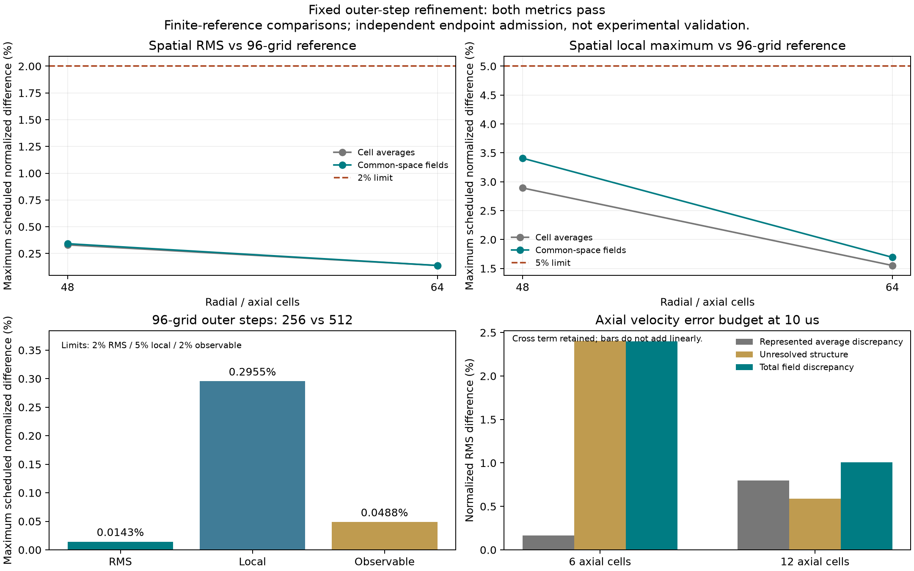

# Separate spatial and timestep refinement

Supplement to [v76](SPATIAL-CONVERGENCE-V76.md). Research backend only.
The original negative cell-average verdict and positive common-space verdict
remain unchanged. No physical equation, coefficient or acceptance limit changes.

The v76 finest comparison used 48²/256 versus 96²/512, changing space and outer
timestep together. Opposite signed errors can cancel. In plain terms, making
two numerical changes at once can make a result look more stable than either
change alone. A regression reproduces this false acceptance exactly.

The new plan freezes two additional trajectories before execution:

- 64² with 256 outer steps.
- 96² with 256 outer steps.

The same-source 48²/256 and 96²/512 trajectories are reused byte-for-byte from
study05. This provides 48/64/96 spatial comparisons at one outer timestep and
a separate 256/512 timestep comparison on 96². Grid placement, initial continuum
profiles, output times and material/electrical inputs remain identical.
Hydro/diffusion still subcycle at CFL 0.3, so their inner timesteps depend on
the grid; "fixed timestep" here specifically means the outer source/split step.

Both cell-average and common-space comparisons must pass the original limits:
2% RMS and observable difference, 5% local difference. Each metric has 315
gates, covering all nine fields, fourteen observables, three physical times,
both spatial levels, a decreasing-error check and the independent timestep
comparison. No coarse sample or old failed gate is removed.

The checker also decomposes coarse axial-velocity error into its represented
cell-average error and the unresolved reference structure. The squared L2
budget includes their cross term and must close to arithmetic tolerance.
Signed observable budgets separately expose spatial/temporal cancellation.
Neither decomposition is an experimental uncertainty estimate.

This is a focused evidence extension rather than a solver rewrite: no new
solver defect has been demonstrated since v76. Existing FiPy transport and
the independently checked conservative state are retained. The study does not
claim a Richardson/GCI error bound or a universal convergence order.
[NASA's grid-convergence guidance](https://www.grc.nasa.gov/www/wind/valid/tutorial/spatconv.html)
explains why the asymptotic regime and physical accuracy need separate checks.

All execution is offline through safe-dev. The physical producer, supplementary
source, imported metric, checkpoint helper, runtime, baseline and plan hashes
are bound before production. Each completed trajectory is saved in persistent
guest storage before the project checkpoint. Every recorded substep audit and
its reported score, minima and timing are inspected. Endpoint observables and
ledgers are independently reconstructed; intermediate transport residuals are
not reconstructed from saved stage states. The PDE is not replayed by admission.

Both new trajectories complete without producer failures: 512 new outer steps
and six new endpoints. All **630 supplemental gates pass**, 315 per metric.
Independent endpoint admission covers 26 trajectories / 78 endpoints including
the 24 reused trajectories; maximum reconstructed observable discrepancy is
5.17e-13. This admission checks recorded audits and ledgers, not a second solve.

Maximum normalized differences across scheduled times and fields/observables:
Observable normalization uses the maximum absolute reference value over the
scheduled times, not each instantaneous value.

| Comparison | Metric | RMS | Local | Observable |
|---|---|---:|---:|---:|
| 48²/256 versus 96²/256 | Cell average | 0.331% | 2.893% | 1.404% |
| 64²/256 versus 96²/256 | Cell average | 0.138% | 1.552% | 0.585% |
| 48²/256 versus 96²/256 | Common space | 0.342% | 3.408% | 1.404% |
| 64²/256 versus 96²/256 | Common space | 0.138% | 1.693% | 0.585% |
| 96²/256 versus 96²/512 | Both, rounded | 0.0143% | 0.2955% | 0.0488% |

The old six negative coarse-velocity monotonicity checks remain negative in
their original receipt. At 10 µs, six axial cells have only 0.168% represented
average discrepancy but 2.402% unresolved structure. Total reconstructed field
discrepancy falls from 2.397% on six cells to 1.008% on twelve, although the
represented-average term increases. This supports coarse averaging as the
explanation for that apparent reversal. Cross terms are retained, so the RMS
terms do not add linearly.

Some signed spatial and temporal observable differences cancel. For example,
outer-wall torque at 10 µs has +0.0245% spatial and −0.00324% temporal
differences on the original observable scale. The isolated checks pass without
depending on this cancellation. These are finite-reference comparisons at
10, 20 and 40 µs, not continuum error bounds or validation of other parameters.

Verification: **194 Python tests and 15 TypeScript tests pass**; typecheck,
build, site and asset checks exit zero. The existing large-bundle warning
remains. The unchanged PDE retains the physical limitations listed in v76;
experimental and live-playground qualification remain false.

[The subsequent adversarial overfitting audit](OVERFITTING-AUDIT-V78.md)
finds a relative wall-heating blind spot, missing untouched physical holdouts
and a receipt-consistency weakness. The original numerical verdicts remain
unchanged; the 630 gate rows are correlated checks of one physical condition.

Evidence: [summary](../scientific/spatial-v77/summary-01.json),
[all gates and budgets](../scientific/spatial-v77/convergence-01.json),
[pre-run plan](../scientific/spatial-v77/plan-01.json),
[exact checks](../scientific/spatial-v77/checks-01.json),
[execution record](../scientific/spatial-v77/EXECUTION.md),
[compressed raw trajectories](../scientific/spatial-v77/study-01.json.gz),
[source overlay](../scientific/spatial-v77/frozen-source-01.tar.gz), and
[artifact hashes](../scientific/spatial-v77/artifact-index-01.json).
Extract the v76 source archive first, then the v77 overlay; replay instructions
and exact archive dependencies are in the execution record.

