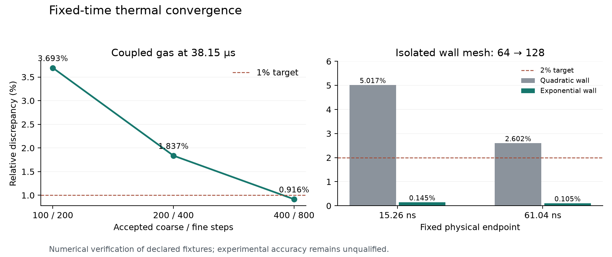

# Fixed-time local thermal refinement, v69

This stage investigates the remaining v68 local thermal errors in the experimental
spatial centrifuge backend. It changes no production equation, property fit,
solver tolerance, supported grid size or deployed default. Experimental accuracy,
arbitrary slider settings and long-time device performance remain unqualified.

## Diagnosis and reviewable changes

The v68 first shared wall-surface differences were 4.64% under time refinement
and 5.51% under wall refinement, despite passing whole-history norms. The first
quadratic time knot moves when its nominal step count changes. Backward Euler
has a temporal truncation error, and a hot-wall diffusion layer needs spatial
resolution independently of that error. In simple terms, taking smaller steps
cannot resolve a wall layer that has too few cells. Fixed physical checkpoints
separate those two causes.

The candidate wall grid is the existing explicit-grid API with
`r_i = R + d expm1(8 i/N)/expm1(8)`. It retains the 128-cell cap and concentrates
cells smoothly near the gas-facing wall. It is a controlled mesh experiment,
not a new conduction law. The stretch was declared before scoring. Changing
the existing grid is narrower than increasing its supported size or replacing
the nonlinear thermal solver before identifying the limiting error.

The gas failure is separate: cell 1 cools and then reheats around 38.15 microseconds.
The prior 0.002171 K difference on a 0.014653 K causal excursion was resolved,
not roundoff. Nominal quadratic schedules of 512/1024/2048/4096 steps are compared
through that same endpoint, using 100/200/400/800 actual coupled steps. Every
accepted step reevaluates species, electrical forcing, momentum, gas enthalpy
and nonlinear solid conduction together. Keeping these real steps preserves
their work and conservation ledgers; a temperature-only correction or extrapolated
state would not inherit those identities.

The limiting thermal benchmark uses the actual mixture thermal kernel, with
fixed species, no sources, no external cooling, constant neutral-Li conductivity
and a uniform 1100 K gas / 1200 K wall. An independent SciPy symmetric eigensystem
and matrix exponential evolve its frozen-property finite-volume graph. The closed
heat mode is projected out analytically, and increments are computed without
subtracting two 1200 K backgrounds. This is fixed-graph numerical verification;
it is not a continuum reference or an exact nonlinear solution. Actual nonlinear
wall-property variation is reported separately. Its numerical resolution allowance
is estimated, not a certified bound.

## Validation defects corrected before scoring

The first endpoint scorer reported the new 1% gas criterion but did not include
it in process acceptance. A failed local study could therefore exit successfully.
It now requires the criterion for the explicit gas-prefix time pairs, requires
the known reversal cell to have a resolved signal, and rejects an empty resolved
set. Three regressions cover reversal normalization, a resolved failure and
unresolved/missing reference signals. No denominator floor is introduced.

The reference scorer originally reported numerical uncertainty without enforcing
it. Finest external comparisons now require an estimated resolution allowance
no greater than 0.1% of the relevant physical increment, reserving at most 10% of
the predeclared 1% discrepancy budget. The allowance is not subtracted from error.
Exported heat must also match independently reconstructed physical magnitudes;
matching heat direction alone cannot pass. Failed assessments exit nonzero and
retain their reports. Regressions include uncertain tiny signals, same-sign heat
corruption, missing provenance, incomplete studies and failed CLI acceptance.

An executed CLI regression then caught a NumPy boolean in the report. Tolerance
arithmetic produced `numpy.bool_`, which standard JSON cannot serialize. The
audit constructs a native boolean explicitly and serializes before opening its
exclusive output file. This fixes the demonstrated report boundary without a
generic serializer or partial-file fallback. The failing test and traceback
remain evidence. All 14 new unit tests subsequently passed inside safe-dev.

## Protocol and evidence

The prospective [protocol](../scientific/thermal-local-v69/PROTOCOL.md) and explicit
[case specifications](../scientific/thermal-local-v69/specifications.json) define
the gates and retained coarse failures. All runs use an offline Apple safe-dev VM
with copied source, checked before and after execution. The frozen 744-entry
snapshot is `5134e97644469f1e82ec9b04a397a4c60090532237544e4b1e9902d0f4fc173d`.
Two historical stage-only gate scripts are included in that manifest and absent
from the host checkout; their status is explicit in every controller receipt.

The initial seed is extracted from the complete, hash-verified v68 anchor.
It binds baseline packet SHA-256
`286543ae336ccc70cf37a24b960de015249000604108ceadd8070e43def2fad2`
and baseline source
`4d28113802de70f2624f3d5146f5e8f22508103e6ae8f255575d2ea62d935631`.
The thin seed SHA-256 is
`0fc09b3952683b2eaa0957a3da7d096a3c997ad0174106c3dba6fb037f118859`.
New packets bind their actual source, specification and seed hashes. Accepted
NDJSON records and partial failures are preserved rather than overwritten.

## Limiting thermal results

All 48 declared cases completed on the common snapshot, retaining 1,020 accepted
thermal steps. Every independent heat, energy and entropy step audit passes.
The largest row residual divided by its explicit tolerance is 0.02030; the
maximum raw global energy defect is 2.244e-13 J. The largest relative nonlinear
wall-property changes are 3.826e-9 in Cp and 5.111e-9 in conductivity. These
small variations support the stated frozen-property diagnostic scope; they are
not a general nonlinear error bound.

| Fixed physical endpoint | Surface error vs independent graph | Gas profile error vs independent graph | Wall 64→128 surface change | Time 16→64 surface change |
| --- | ---: | ---: | ---: | ---: |
| 15.258789 ns | 0.19529% | 0.01698% | 0.14455% | 0.58459% |
| 61.035156 ns | 0.19595% | 0.06161% | 0.10529% | 0.58657% |

These are the exponential-grid results. They satisfy the prospective 1%
external/time and 2% space limits with the reference-resolution check enforced.
The original quadratic wall pair still differs by 5.0166% and 2.6022% at the
same two endpoints; those failures remain in the report. Thus subdividing time
alone does not remove the demonstrated spatial error. Per-cell near-zero gas
tails are retained without a pointwise qualification.

The independent eigensystem defect is at most 2.322e-15; its largest increment
disagreement with the matrix exponential is 5.169e-10 K. The estimated resolution
allowance consumes 0.124% and 0.224% of the respective surface discrepancy
budgets, below the declared 10% allowance. Neither numerical method is an
independent physical experiment or a continuum solution.

## Fully coupled results

The first 100/200-step gas prefixes complete and pass all 410,100 independent
coupled checks. All 18 deliberate corruptions are rejected. The controls act on
each case's first accepted transition; every original transition is separately
audited. The global history, surface and electrical gates pass, while the new
local endpoint criterion fails and correctly makes that assessment exit 1.

The worst cell is the known cell 1 reversal: its endpoint difference is
0.000543578709 K over a 0.014718222648 K fine causal excursion, or 3.69324%.
The fine gas cools from 1002.34375 K to 1002.3290317773522 K before reheating to
1002.3567729114106 K. This is a physically resolved cooling/heating history,
not a tiny denominator manufactured from the final value alone. The absolute
error is about one quarter of the earlier 128→256 pair after skipping two
doublings, consistent with ordinary first-order timestep error. The finest
pair must separately demonstrate the declared 1% criterion, rather than inheriting
a pass from those global norms.

The finer pairs do demonstrate that target:

| Nominal quadratic schedules | Actual accepted prefix steps | Cell 1 raw difference | Fine causal excursion | Local relative difference | 1% gate |
| --- | ---: | ---: | ---: | ---: | --- |
| 512→1024 | 100→200 | 0.000543578709 K | 0.014718222648 K | 3.69324% | Fail |
| 1024→2048 | 200→400 | 0.000271833336 K | 0.014793837771 K | 1.83748% | Fail |
| 2048→4096 | 400→800 | 0.000135926606 K | 0.014831648450 K | 0.91646% | Pass |

All 64 endpoint signals are resolved; cell 1 remains the largest relative error.
The largest absolute endpoint difference is instead 0.002694 K in cell 62, whose
causal excursion is much larger. The three raw cell 1 differences approximately
halve under each doubling, supporting the timestep diagnosis. The finest pair
also has maximum 0.91646% across its resolved shared gas times; this is an
additional observed diagnostic, not a uniform error bound between outputs.

All eight coupled cases complete, retaining 2,140 accepted steps. Their 2,884,420
independent coupled checks pass, including species, evolving inertia/momentum,
heat/work, canonical energies and conditional total entropy. All 72 corruption
controls are rejected with the documented first-transition scope. The smallest
conditional total entropy increment is 1.28975e-12 J/K and the maximum raw global
energy residual is 3.98519e-12 J; storage allowances remain explicit. All five
pairs pass their 90 original global/surface/electrical refinement observables.
Both coarser gas assessments nevertheless exit 1 for the required local gate.

The actual coupled 64/128-cell exponential-wall startup pair agrees to 0.14456%
at the predeclared 15.258789 ns endpoint: 1.73222e-8 K on 1.19828e-5 K of fine
surface response. Its whole-history surface norm is 0.26632%. The full 1 ms
wall pair passes all legacy gates; its surface whole-history difference is
0.07161%, and its maximum shared-time local surface difference is 0.16585%.
These are two-level mesh sensitivities on the declared fixtures, not continuum
error estimates.

Initial evidence is retained under
`scientific/centrifuge-v44/thermal69/studies/initial/`; its 26-file export manifest
SHA-256 is `4677a27b00472f8c08c8ac7d7688441b38d2edac463b466b8943571f0bde8660`.
The raw benchmark and the exact rehydratable gas-pair packet are included.
Coupled/coarser evidence is in `studies/coupled/` (manifest
`7309805aec23f06f6d8f6b54b2d5008562a0ce36038ef5378fa06ab1b6cbe2b6`),
and fine gas/full-wall pairs in `studies/finest/` (manifest
`c8e02ed8e33c8a6f7932858f7f729f2aeccaf269c5b826aecf07537d9bd415bf`).
The complete 744-input source capsule is independently verified under
`studies/source-seal/`: archive SHA-256
`7d5da33cd7f3d86b773ddb3e7824a286016cc2c85a3e280d2b21dc3a6d64b3b5`.
All 142 production source files match the v68 tested snapshot.
All eight original standalone packets are also retained as exact gzip archives.
`studies/packet-archives.json` maps their raw hashes to compressed paths and
hashes. Original export manifests describe the raw files before compression;
each archive was fully decompressed and checked against those original hashes
before its redundant uncompressed host copy was removed. The total 1,057,959,367
raw bytes are recoverable from 470,366,524 compressed bytes. Accepted NDJSON
ledgers are retained separately in the guest, with verified lossless compression
for the six longer cases. No unique result or failed comparison was deleted.

The figure's left panel uses the full coupled gas prefixes. Its right panel uses
the controlled isolated thermal benchmark, so it compares the two wall grids
with the same physical inputs and substeps. PNG/SVG and input hashes are retained.

## Final checks

Every check below passed inside the offline VM on that same 744-entry snapshot:

| Exact check | Result |
| --- | --- |
| `python -m unittest discover -s scientific/thermal-local-v69 -p 'test_*.py'` | 14 passed |
| `python -m unittest discover -s scientific/resolved-v68 -p 'test_*.py'` | 9 passed |
| `python -m unittest discover -s scientific/transient-v67 -p 'test_*.py'` | 28 passed |
| `npm test` | 1,231 passed, none skipped |
| `npm run typecheck` | Passed |
| `npm run build` | Passed; existing large-chunk warning remains |
| `npm run check:site` | Passed; static parsing/resources, not browser execution |
| `npm run check:assets` | Passed; GLB/PNG/Blender structure, not GPU verification |

Python commands use `/work/home/thermal-v53-venv/bin/python`. Exact controller
commands, logs and before/after source receipts are retained under
`scientific/fixes-v43/thermal69-*`. The failed first unit run and its serialization
traceback remain alongside the passing 14-test run. Typecheck/build were executed
once at the final gate. No deployed browser or GPU acceptance follows.
Runtime versions are NumPy 2.4.6, SciPy 1.17.1, FiPy 4.0.3 and Matplotlib 3.11.2.
FiPy is installed but was not rerun for this stage; its fresh v68 electrical
benchmark remains separate evidence. The new independent evolution reference
actually executed SciPy. Host work was source editing, trusted archive transport
and evidence review; scientific studies, tests and plots executed in the VM.
The final document/review copies and cross-artifact integrity index are retained
in `studies/review-closeout/` and `studies/CLOSEOUT.json`.

## Boundaries and next work

This experiment cannot qualify the earlier radial gas error, every local solid
tail, or uniform relative accuracy at every startup instant. The finest gas-time
pair retains a 4.130% local surface-time difference at 0.2384 ns. The coupled
uniform-substep startup mesh pair retains a 2.3846% local surface-space difference
at that same early time, despite passing its declared 15.26 ns checkpoint. Solid
local relative gates still fail on roughly 1e-10 K changes. Those diagnostics are
not removed or reclassified as a comprehensive local pass. The short gas
prefix isolates time on the retained quadratic wall; the separate wall study
isolates its mesh. A combined production controller still needs coupled error
control and a joint refinement study before changing live defaults.

The physical backend still prescribes conductivity and neutral transport and
extrudes one radial angular-speed field through the electrical axial mesh. It
does not close the electron/discharge state, ionization, phase changes, chemistry or radial
hydrodynamics. The [public experimental benchmark](EXPERIMENTAL-BENCHMARKS-V64.md)
retains its pressure-response disagreement. Numerical convergence here does not
repair that constitutive gap or establish Marathon calibration. A useful
first-order predictive claim needs a converged case plus a held-out physical
observable with justified inputs and uncertainties; these are separate gates.
After these targeted numerical gates, the next priority is a source-bound,
temperature-conditioned Ar velocity holdout and then a matched pressure holdout,
rather than further isolated microscopic thermal-tail refinement.

A fresh review of [Hood-McFadden et al., Appendix A and Sec. 2](https://arxiv.org/pdf/2607.28208v2)
confirms a relevant next reference: coupled heavy/electron energy, collision-based
magnetized conductivities and radial force balance. Its local Saha closure is
explicitly an approximate upper-limit estimate outside LTE, not a measured
ionization law. Reusing that closure therefore requires its own regime and
held-out-data checks. No released solver or dataset was identified by the
bounded code/data-availability text search in that PDF; this does not establish
that none exists elsewhere.

Independent reviewers inspect source and exported evidence; the parent alone
executes and syncs the VM. See the [physics review](reviews/v69-thermal-physics.md)
and [numerical-method review](reviews/v69-method.md).
