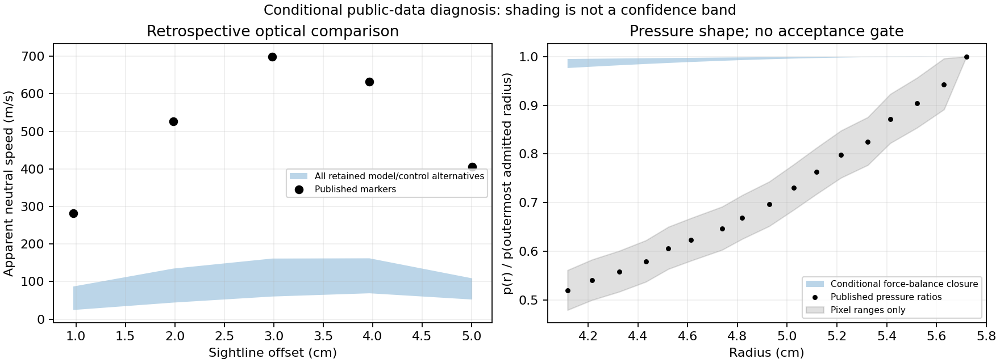

# Public-data qualification campaign

Started 16 November 2026. Scope frozen before new campaign execution. No author
requests, parameter fitting, relaxed historical gates or Marathon-device claims.
The live rigid-rotation model and spatial research references remain distinct.

**Current result: component and angular-reference numerical checks pass; the
model still misses the published rotation/electrical observations. Its extra
pressure-shape closure also disagrees. Experimental qualification remains false.**

## Work and acceptance criteria

1. **Published observations:** retain existing five-point neutral rotation
   extraction, and admit additional observations only with apparatus identity,
   source/crop hashes, raw pixel coordinates and extraction ranges. Unknown
   experimental uncertainty stays unknown. Different cathodes/conditions stay
   separate. Previously inspected observations are retrospective evidence.
2. **Component verification:** run production paths against exact mechanical,
   equilibrium, electrical and heat controls. Reuse established tolerances and
   adjacent refinement suites; discrete algebra checks are not continuum tests.
3. **Independent reference:** compare FEniCSx and the established scikit-fem
   angular/current reference with identical equations, coefficients, contacts,
   boundary conditions and sampling. Require conservation and refinement; code
   agreement does not validate the experiment. Audit the public notebook before
   reuse and document any necessary corrections.
4. **Unknown-input sensitivity:** retain all original V82 source alternatives
   and diagnostic controls. Summarize envelope/conditional trends without
   selecting the best residual or calling discrete alternatives a probability
   distribution. Retain the original optical numerical and point-match gates.
   Pressure comparisons without a justified observation/uncertainty model are
   diagnostics, not newly invented experimental pass/fail gates.
5. **Playground:** show explicitly selected coefficient sensitivity through the
   live backend, with shared clocks, current-setting identity and stale-result
   invalidation. No invented physical ranges or confidence labels. Existing
   numerical evidence qualifies only its tested nodes and settings, not the
   continuous slider domain or experimental fidelity.

## Interpretation boundaries

Temperature supplied to transport cannot also be scored as a predicted thermal
output. Corrected arc voltage and simulated plasma-port voltage remain distinct.
Normalize pressure only through an explicitly declared boundary or ratio
observable; never fit inventory to improve agreement. Do not interpolate or
transfer recorded argon predictions to the live lithium scenario.

## Execution and documentation

Scientific calculations, tests and builds run inside resource-limited isolated
containers, not on the host. Record source hashes, dependency versions, commands,
outputs, failures and exclusions. This document is the entry point; supporting
protocols and review receipts retain detail. README remains unchanged.

## Results — 16 November 2026

**Numerical checks passed; experimental qualification remains false.** No new
parameters were fitted and no historical acceptance gate was relaxed. This is a
retrospective diagnosis of published argon observations, not a Marathon-device
validation. The existing spatial V82 fields were authenticated and reanalysed;
their field-producing PDE solve was not rerun in this campaign.

| Workstream | Observed result | What it establishes |
|---|---|---|
| Published observations | 17 pressure markers admitted, in addition to the existing five rotation markers and operating-condition scalars | Traceable observations from the same historical apparatus; unknown experimental error remains unknown |
| Production components | 60/60 metrics passed; two component tests passed, including artifact-corruption cases | Exact mechanical, equilibrium and electrical limits, and discrete backward-Euler heat algebra |
| Independent reference | All five tests and the frozen numerical screen passed | Agreement of independent DOLFINx and scikit-fem implementations of the same conditional angular/current equations |
| Retained experimental alternatives | 4,320 optical comparisons; zero all-point matches; 60 electrical alternatives predict 17.25–34.20 A against reported 100 A per branch | The retained transport/diagnostic alternatives do not explain the discrepancy; the plasma-port voltage mapping remains unresolved |
| Live playground | Optional user-selected coefficient samples run through the actual coupled worker | Conditional sensitivity of this model, without invented priors or an experimental accuracy claim |

The FEniCSx angular-field difference between implementations is at most
1.63×10⁻¹⁰ relative. Its coarse/fine mesh changes are 8.53%/0.466%, satisfying
the unchanged fine-grid 5% criterion. Algebraic work and source-moment torque
residuals are below 10⁻⁸. However, electrode power increases from 2,579 to 2,873
to 3,157 W as the mathematical point contacts are refined. **Contact voltage,
local Joule heating and integrated electrode power are not continuum-qualified.**
Finite electrode footprints remain necessary for those observables. Temperature
is absent from this reference, rather than an independently predicted output.

The added pressure comparison integrates the *additional assumption*
`dp/dr = rho v_theta²/r` using prescribed temperature and the stored local flow.
Pressure is divided by the predeclared outermost admitted marker; no inventory
or pressure scale is fitted. Measured ratios rise from 0.519 to 1, whereas the
conditional model profiles are almost flat. The maximum nominal ratio discrepancy
is 0.457–0.476 across retained cases. Integration refinement changes ratios by
less than 4.31×10⁻⁹; this isolates quadrature error, **not** PDE or physical error.
Shared-denominator pixel boxes are correlated; radius/probe-response uncertainty
is not propagated. There is no invented pressure acceptance threshold or
statistical rejection. The comparison excludes the separate wall channel beyond
6 cm and the central extrapolation, which is not a measured point.

The largest sampled conditional optical spans are 68.5 m/s between transport
scenarios, 37.0 m/s between estimators, 37.0 m/s across diagnostic temperatures,
and 31.7 m/s across voltage hypotheses. These are discrete alternatives with
other choices fixed, not physical uncertainty bounds or a ranked causal proof.
In particular, a small span for the tested anode positions does not establish
insensitivity to an untested cathode footprint. Ion-line temperature and wall
thermocouple readings remain distinct diagnostics; prescribed temperature cannot
also validate a thermal prediction.

## Reproduce and inspect

- [Observation inventory and extraction coordinates](../scientific/public-data-campaign/observations.json),
  [admission review](reviews/public-data-coverage-20261116.md), and
  [no-fit diagnosis](../scientific/public-data-campaign/results/diagnosis.json).
- [Component implementation review](reviews/public-components-20261116.md),
  [independent physics review](reviews/public-components-independent-20261116.md), and
  [60-metric receipt](../scientific/public-data-campaign/results/components.json).
- [FEniCSx frozen protocol](../scientific/public-fenicsx-reference/PROTOCOL.md),
  [reference review](reviews/public-fenicsx-reference-20261116.md), and
  [reference receipt](../scientific/public-fenicsx-reference/results/reference.json).
- [Live sensitivity execution/lifecycle review](reviews/public-sensitivity-20261116.md).
- [Exact run manifest and logs](../scientific/public-data-campaign/results/RUN.md).
  The workflow `.github/workflows/public-data-qualification.yml` reproduces the
  isolated checks on explicit dispatch; its existence is not a successful CI run.

Application verification: the final integrated candidate passed **1,357 tests**,
all **11 targeted sensitivity tests**, `npm run typecheck`, `npm run build`,
`npm run check:site` and `npm run check:assets`. The full suite was rerun after
the final UI identity/evidence-link additions. See RUN.md for exact receipts.
Build warns about the existing large main bundle.
These checks do not establish experimental fidelity.

## What remains

### Finite-current footprint continuation

The next conditional numerical step is complete. The new independent DOLFINx
and scikit-fem reference replaces zero-area point loads with finite, surface-area
normalized current patches. Fixed physical widths remove the mesh-dependent
cutoff without clipping heating, changing conductivity or fitting observations.
The historical point-ring source and receipts are preserved unchanged.

All three predeclared footprint hypotheses passed the original 5% angular-field
and 1e-8 budget screens, and the added 5% fine-change/contraction screens for
integrated power and voltage. Final mesh changes are 0.30–0.45% for angular
flow, 0.12–0.86% for port voltage and 0.15–1.05% for integrated Joule power.
The largest independent-code difference is below 1.33e-9 relative. Seven new
physics tests cover source balance/moments, wall torque, work, independent
assembly, gauge invariance, reversals, drive scaling and fixed support geometry.

At imposed 100 A, the narrow/middle/broad hypotheses give current-weighted port
voltages 21.86/18.12/14.11 V. **These are not independent experimental voltage
predictions.** The inherited fixed conductivity ratio corresponds to Hall
parameter 3, historically inferred using electrical observations; the emission
footprints and corrected-voltage operator remain unidentified. No new parameter
was fitted, but that does not erase the inherited calibration provenance.
The 2 cm anode band has a metal-geometry basis; uniform current on it remains
an assumption. The hollow cathode's 4 mm inner radius is not its emitting width.
The supports are paired illustrative alternatives, not measured uncertainty
bounds or an isolated causal study of either contact.

This qualifies integrated electrical work only within the stated stationary,
fixed-property angular model. It does not qualify peak local heating at sharp
patch edges, equipotential metal electrodes, sheaths, thermal evolution,
meridional flow, or the live lithium playground. Experimental qualification
remains false.

See the [frozen protocol](../scientific/finite-contact-reference/PROTOCOL.md),
[run and independent-review record](../scientific/finite-contact-reference/results/RUN.md),
and [complete compressed field/budget receipt](../scientific/finite-contact-reference/results/campaign.json.gz).

### Remaining physical identification

A physically justified finite cathode/anode current footprint and plasma-port
voltage mapping are still needed, followed by matched
non-rigid neutral/ion momentum, meridional transport and energy predictions.
No benchmark input should be selected because it reduces the measured residual.
A new output/condition withheld from model development is needed for a prospective
experimental test; these already examined figures cannot become a fresh holdout.
The live lithium playground remains useful for conditional exploration, with
its rigid-rotation and prescribed-transport assumptions visible in Model info.
