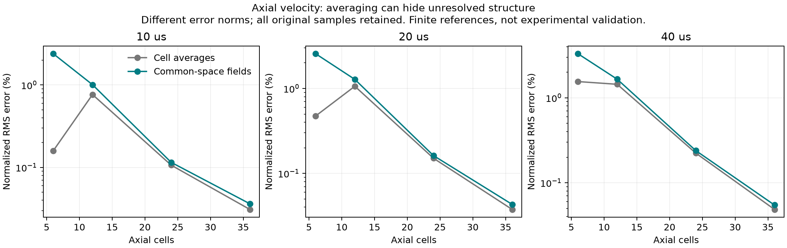

# Spatial convergence

Research backend only. The original negative v75 study is retained. Numerical
convergence does not establish experimental accuracy or qualify the playground.

Study05 completes 24 trajectories, 5,472 outer steps and 72 independently
admitted endpoints without producer failures. **All 615 common-space gates
and all six reference checks pass.** The original cell-average report remains
negative on six coarse axial-velocity monotonicity checks; its finest accuracy
limits all pass. These are separate verdicts, not a relabeled original pass.

## Causes reproduced before changing the solver

**Comparison aliasing.** The analyzer treated every reference cell as constant
when integrating partial overlaps. On a nonnested 48→36 grid, even an exact
linear axial field acquired a maximum error of 0.2430556 mm (h_reference/12).
Simply, the comparison introduced a staircase before the gas moved. Integrating
the first moments of conservative linear reconstructions in z and s=r² removes
this error while preserving donor-cell integrals. Linear/bilinear, nonuniform
cylindrical and conservation regression controls pass. This was chosen over
dropping the 36-cell case or increasing the error allowance. Reanalyzing old
study01 reduces failing series gates from 74 to 67; its spatial reference still
fails. Old convergence01 is unchanged. The reanalysis is post-processing, not
a new solve or a qualification receipt.

**Excess first-order flux diffusion.** A smooth constant-pressure contact with
linear axial density and +3 m/s velocity produced a negative first-order
numerical mass flux at the tested interior faces. The Rusanov acoustic penalty
acted on the cell-to-cell density jump instead of reconstructed states at the
same face. Simply, numerical spreading overwhelmed the actual flow. Limited
primitive MUSCL reconstruction now uses cylindrical volume centroids and
actual center-to-face distances. Both sides use the same face radius for swirl;
species and angular momentum retain the common numerical mass flux. The
contact regression and closed-domain conservation controls pass. Acoustic
errors decrease strongly over 6–96 cells. This retains the checked conservative
state, SSPRK2 integrator and FiPy source rather than replacing the entire PDE
backend. It is not a claim of exact rotating balance or a general positivity
proof for the full nonlinear system.

**Unresolved developing endwall gradient.** For constant rho=0.001 kg/m³ and
mu=2.54e-5 Pa s, stress-free outer radius, stationary endwalls and
Omega(z,0)=900 sin²(pi z/L), the exact equation is Omega_t=(mu/rho) Omega_zz.
The independent sine expansion has coefficients 8/[pi n(4−n²)] for odd n.
Endwall torque is minus (pi mu R⁴/2) times the axial derivative at the lower wall.
The initial wall derivative is zero; this is not an impulsive wall-speed jump.

At 10 microseconds, with the same 256 backward-Euler steps:

| Axial cells | Uniform error | Tanh wall-grid error | Smallest graded cell |
|---|---:|---:|---:|
| 24 | 250.78% | 11.33% | 0.486 mm |
| 48 | 90.72% | 2.69% | 0.218 mm |
| 96 | 22.93% | 0.528% | 0.103 mm |

Simply, the original uniform mesh placed too few cells inside the wall layer.
The manifest now specifies wall-refined r and z grids. No viscosity, wall
condition, empirical drag or heat correction was fitted. This preserves the
energy-compatible FiPy shear/thermal operators; changing only reported wall
gradients would break their connection to actual momentum loss and heat.
These figures isolate the grid effect and are not coupled-case accuracy claims.

**Under-resolved axis.** The first coupled rerun completed all 21 trajectories
without a producer failure, but its 48→96 comparison still had 5.1217% local
early density-change error at the axis/endwall corner. The outer-wall-only
radial stretch left a 2.592 mm first cell at 48 radii, versus 0.191 mm at the
outer wall. Thus the wall fix traded away axis resolution. A separate small
amplitude cylindrical acoustic mode, with J1(kR)=0 and exact J0 initial cell
integrals, reproduces the error without thermal/current coupling or initial
sampling error. At 10 microseconds:

| Radial cells | Outer-wall-only maximum error | Axis-and-wall maximum error |
|---|---:|---:|
| 24 | 12.08% | 11.77% |
| 48 | 15.12% | 2.148% |
| 96 | 7.224% | 0.464% |

Errors are relative to the analytical density-change amplitude, not bulk
density. The symmetric tanh grid has a 0.199 mm first cell at 48 radii, while
retaining a similar outer-wall cell and minimum transport step. Simply, both
ends of the radial domain need resolution. This changes mesh placement, not
the Euler equations or material coefficients. It is chosen over adding a
special axis force, fitting a closure, or accepting a larger error. The actual
reference-grid acoustic regression fails before this change and passes after.
The acoustic solution is a linearization at amplitude 1e-4, not an exact
finite-amplitude Euler solution; amplitude and timestep controls are recorded
separately.

The acoustic benchmark is derived from linearized cylindrical Euler flow:
delta_rho=epsilon*rho0*J0(k*r)*cos(c*k*t),
u_r=epsilon*c*J1(k*r)*sin(c*k*t), and delta_p=c²*delta_rho.
Choose the first zero of J1(kR), imposing zero outer-wall normal velocity.
The annular J0 average is
2*[b*J1(k*b)-a*J1(k*a)]/[k*(b²-a²)].
The derivative and integral identities are given in the
[NIST DLMF](https://dlmf.nist.gov/10.6.E3) and
[its Bessel integral formula](https://dlmf.nist.gov/10.22.E1).
This is an independently derived control, not an imported experimental dataset.

## Coupled verification

Fine wall cells impose a smaller explicit transport timestep. Hydro and binary
diffusion now subcycle separately at CFL 0.3, recording and checking **every**
inner endpoint. Each operator must cover the full outer dt in the right order.
Regression controls reject a missing substep, an earlier failed audit and an
incorrect total elapsed time. A new CFL 0.15 comparison must pass a separate
0.1% profile/observable gate. The outer source/time/joint studies still measure
Lie splitting and backward-Euler errors. The original 2% RMS/observable and
5% local spatial gates are unchanged.

The first frozen v76 run starts from safe-dev snapshot
`388744586d65ed768f4725ae26e15580ad8e20ef96948b8eb81baa72e3b1deef`
(1651 files, 263449115 bytes). Its pre-run source map is authoritative.
All 105 tests passed before this run (14.378 s). All 21 trajectories finish
without a producer failure. Its series failures are joint 0, spatial 10,
radial 3, axial 7, temporal 0, versus the original 74 total. Tighter solver,
smaller outer timestep and transport CFL checks pass. The fine spatial
reference still fails on the 5.1217% local density-change result above.
`study-02.json`, `convergence-02.json`, and `frozen-source-02.tar.gz` retain
this negative outcome; it is not numerically qualified.

The axis-and-wall revision uses safe-dev snapshot
`11d25d220353865f1c065913e33165956a6ddd9fed84565463800b0fc25ca12f`
(1664 files, 315131845 bytes). Its copied source remains isolated from later
host documentation edits. All 21 trajectories finish without producer failures.
All six tolerance/timestep/fine-spatial/CFL reference checks pass. The worst
48→96 local density-change difference falls from 5.1217% to 3.1416%.
The original sampling still fails 21/615 series gates: 24 cells do not resolve
wall torque and gas temperature; a coarse axial velocity error is nonmonotonic.
The exact source and negative study03 are retained.

A separately frozen sampling extension adds 36-cell spatial, radial and axial
trajectories, without modifying the physical source or any threshold. Independent
admission checks all 24 trajectories and 72 endpoints. Every finest accuracy
threshold passes, leaving only the coarse axial velocity monotonicity gate.
Its normalized RMS values are 0.8558%, 1.1338%, 0.1894% and 0.04952% for
6, 12, 24 and 36 axial cells. The extension receipt remains **failed**.

**Mesh-dependent initialization.** The producer sampled initial primitives at
geometric midpoints and reconstructed conserved cell totals. That is not the
integral of the stated continuum fields, especially for angular momentum and
total kinetic energy. Simply, different meshes started with different physical
inventories. On the 3×3 graded regression, angular momentum is 79.23% above the
continuum integral. A pure-Euler ablation isolates this from FiPy/current/thermal
coupling: the old axial velocity normalized RMS sequence is 0.8918%, 1.1409%,
0.1905%, 0.04997%; integrating the same profiles gives 1.5750%, 1.4518%,
0.2253%, 0.04935%. The reference speed scales are 3.5290 and 3.5252 m/s,
respectively. The coarse cancellation disappears without changing
the velocity pattern.

The revised producer integrates all six conserved fields with 12-point tensor
Gauss-Legendre quadrature, including the full kinetic-energy integrand. An
independent 16-point SciPy quadrature checks initialization. Regression tests
check continuum total mass M, light mass 0.5006 M, angular momentum
pi*rho0*Omega0*R⁴*L/12, mesh-independent energy, quadrature-order refinement,
and rejection of stale midpoint states and physical bias near velocity nodes.
Argument/reduction roundoff near trigonometric nodes is bounded at 128 epsilon
of the prescribed local mass times speed envelope; physical refinement limits
are unchanged. This avoids choosing a different initial pattern or masking a
coarse error with a relaxed monotonicity test.

The final manifest retains all coarse levels and adds the independently
demonstrated 36-cell samples. Study04 used snapshot
`c037d94d9d397c311440172677a97006fdedafd775d66e0541b154ab6e1cea69`
(1681 files, 376224216 bytes). Its export exceeded safe-dev's 512 MiB limit;
an erroneous subsequent source sync destroyed the only copy of its outputs.
Those outputs cannot be audited and are not published as evidence. Study05
repeats the same physical code. Before its first trajectory, a separate
common-space analysis plan was frozen and sealed into the raw report.

**Coarse-cell averaging hides unresolved structure.** The original metric
compares a coarse cell average with a reference averaged onto that coarse
cell. This is a valid finite-volume cell-average error, but it can cancel a
wave that the coarse grid cannot represent. A regression demonstrates this
with a two-period sine wave: both coarse averages are effectively zero, while
the field RMS error is greater than 0.70 in amplitude units. Simply, averaging
can hide the feature whose resolution we want to measure.

The additional metric conservatively reconstructs every coarse field onto
one declared reference grid before computing its error. It uses the same
linear overlap integrals, all nine fields, all original samples and gate names,
and the unchanged 2% RMS/observable, 5% local and 0.1% tight limits. Species
fractions use separately reconstructed mass and species mass, including their
initial values for the change diagnostic. Observables retain their original
values. The original cell-average verdict and every failed gate are retained
alongside the new verdict; a different norm does not make the old failed
monotonicity checks pass. This is a represented-field comparison, not a formal
continuum error estimate. Both reports must be read together.

Checkpoint writes now verify a persistent guest backup before replacing the
project copy. Regression tests cover project-copy loss, failed project writes,
stale source and an invalid backup location. Results and source are preserved
outside the project before preparing a bounded export. This changes evidence
handling, not the physical model.

## Final measured outcome

Study05 uses snapshot
`79e48646cf411738da009248a514f25058504a1653bb9f77009a3d998ca2e010`
(1686 files, 376246971 bytes). All values below are maximum scheduled
**common-space normalized** differences, expressed as percentages:

| Comparison | RMS | Local | Observable |
|---|---:|---:|---:|
| 36²→48², fixed 256 outer steps | 0.3503% | 2.7817% | 1.4337% |
| 48²/256→96²/512 reference | 0.3462% | 3.7033% | 1.3785% |
| 48², halved outer timestep | 0.01188% | 0.17824% | 0.04823% |
| 48², transport CFL 0.3→0.15 | 0.000103% | 0.001412% | 0.00000498% |

All joint, spatial, temporal, radial and axial common-space series pass,
including every original coarse level. All three tighter solver checks pass.
The original cell-average report passes 609/615 gates: the six failures are
axial velocity at 10 and 20 microseconds in the joint, spatial and axial series.
They arise at the 6→12-cell transition, not at the finest comparisons. We do
not claim those six checks were repaired by changing the error norm.

The independent admission reconstructs initial states, endpoint observables
and source ledgers and inspects every recorded transport audit. It does not
replay every PDE step and is not an independent solver or experimental result.

Verification: 109 v75 + 17 spatial + 61 adjacent v74 Python tests, 15 relevant
TypeScript tests, `npm run typecheck`, `npm run build`, `npm run check:site`,
`npm run check:assets`, 24 flow gates, 14 diffusion gates, and the positive/six
deliberate-corruption controls all pass. The existing large-bundle warning
remains. No frontend code changed; static site/asset checks are not deployed
browser verification. README remains byte-identical.

Evidence: [summary](../scientific/spatial-v76/summary-05.json),
[common-space receipt](../scientific/spatial-v76/receipt-06.json),
[original negative receipt](../scientific/mixture-axial-v75/receipt-05.json),
[exact checks](../scientific/spatial-v76/checks-05.json),
[execution record](../scientific/spatial-v76/EXECUTION.md),
[compressed raw study](../scientific/mixture-axial-v75/study-05.json.gz),
[frozen replay sources](../scientific/spatial-v76/frozen-source-05.tar.gz), and
[artifact hashes](../scientific/spatial-v76/artifact-index-05.json).
The compressed raw file expands byte-for-byte to `study-05.json`; the raw SHA
is `8e951889c880d477afc81d474a8fd327908ce57eba24ad4c4fe339ae7d5c687d`.

The coupled percentages are finite-reference differences, not rigorous
continuum error bounds. No Richardson/GCI uncertainty claim is made here.
The directional/spatial series hold 256 outer steps fixed. The legacy fine
reference compares 48²/256 with 96²/512, refining space and time together;
it is not an isolated fine-grid spatial uncertainty estimate. Separate
48² timestep and transport-CFL checks remain required.
[NASA's grid-convergence guidance](https://www.grc.nasa.gov/www/wind/valid/tutorial/spatconv.html)
requires checking the asymptotic regime and distinguishes convergence from
physical accuracy. The analytical acoustic and wall controls provide a
separate check against known solutions.

## Method references

- [Mignone, conservative reconstruction in curvilinear coordinates](https://arxiv.org/abs/1404.0537):
  volume-centroid placement, geometry-aware limiting, primitive reconstruction.
- [MPI-AMRVAC slope limiters](https://amrvac.org/md_doc_2limiter.html):
  monotonized-central reconstruction and limits of scalar TVD guarantees.
- [FiPy cylindrical meshes](https://pages.nist.gov/fipy/en/latest/generated/fipy.meshes.html):
  existing nonuniform cylindrical finite-volume machinery retained for sources.

The physical limitations in the v75 report remain: prescribed conductivity,
natural-Ar transport as an isotope surrogate, common heavy-particle temperature,
no meridional viscous stresses, and unvalidated plasma and wall closures.
Nothing here establishes Marathon device performance.
