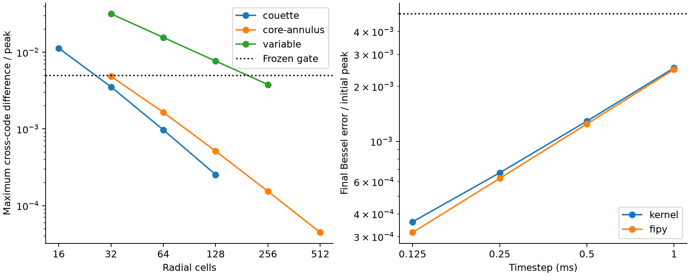
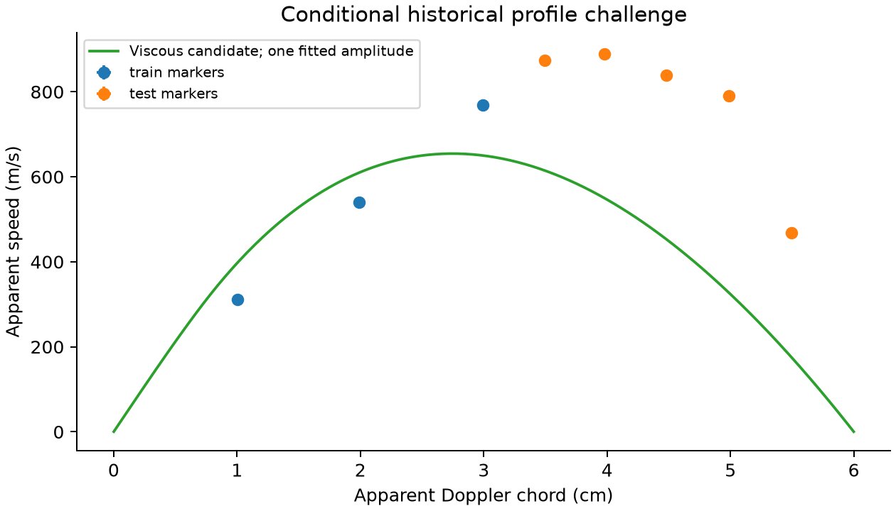

# Spatial momentum: literature, implementation and qualification

10 November2026. **Numerical foundation qualified; first-order experimental
accuracy is not established.** Four independent reviewers examined governing
physics, existing scientific tools, diagnostics/experiments and implementation.
All project execution was performed by the parent in the offline safe-dev VM.

This change adds a standalone radial momentum kernel and reproducible scientific
studies. It does **not** replace the live coupled rotor/species/thermal backend.
The public build is byte-identical to the previously deployed release; no new
deployment or browser verification is claimed.

## Problem and traced execution path

`simulateFuelOperation` → `advanceFuelCoupledStep` in `fuel-transport.ts`
evolves two global angular momenta. Neutral inertia follows the evolving species
second moment, but neutral angular speed remains one number. `advanceFuelGasMass`
uses that speed with an overdamped species flux. The model has no local neutral
shear stress or charge-conserving spatial discharge solution.

Technically, global angular-momentum conservation does not determine the radial
velocity distribution. In plain terms, conserving the total spin does not tell
us which part of the gas spins fastest. The v64 historical profile challenge
already rejected rigid rotation at59.55% held-out RMS/observed-peak error.

The smallest coherent next step is a conserved spatial momentum state, verified
before coupling. Replacing scalar Ω with an array in the existing evolution
would omit species-carried angular momentum and reuse the wrong heat budget.

## Physics implemented

For prescribed density and viscosity, zero radial/axial flow, Newtonian neutral
stress and axisymmetry, the independently derived equation is

```
ρ r² ∂tΩ = (1/r) ∂r(μ r³ ∂rΩ) + r fθ
Icell = (π Lz ρ / 2) (rout⁴ − rin⁴)
Tface = 2π Lz μ r³ ∂rΩ
```

`src/fuel-momentum.ts` integrates the exact cylindrical half-cell resistance
`∫dr/(2πLz μr³)` and applies reciprocal face torques. This exactly represents
steady Couette shear in piecewise-constant viscosity, including material jumps
that conform to a face. Backward Euler gives an implicit tridiagonal update.
No fitted viscosity, angular-momentum projection or artificial torque correction
is applied. A null wall condition means zero stress; it is not stationary no-slip.

Outward-positive radial current and positive axial field give negative azimuthal
force. The helper integrates cell torque as
`−Iout B (rout²−max(rin,a)²)/2`. A positive injection radius is required:
`Jr=Iout/(2πLz r)` cannot represent finite current at the axis. A full gas cylinder
with an unforced core remains distinct from an excluded annular solid electrode.
The prescribed drive cutoff itself still requires a physical return-current path.

The mechanical ledger separates applied work, moving-wall work, gas shear heat,
and backward-Euler numerical kinetic-energy loss. A stationary no-slip wall
removes angular momentum with **zero mechanical wall work**. Shear heats the
gas; subsequent gas-to-wall conduction is a separate process. This avoids
incorrectly routing resolved viscous dissipation into the solid liner.

Two standalone diagnostic helpers provide constant-emissivity Doppler chord
centroids and conditional ideal-barometric isotope log-odds integrals at common
Ω(r),T(r). Neither is an extraction/purity model or a thermodiffusion closure.
The chord helper integrates the piecewise-constant angular-speed field exactly,
including annular holes. Unknown emissivity remains an experimental limitation.

The sourced dilute monatomic neutral-Li option is
`μ=3.14e−8 T^0.863 Pa s`, `κ=1.398e−4 T^0.863 W/(m K)`,100–3000K.
These are published theoretical fits; neither experimental uncertainty nor a
plasma/mixture model is supplied. They are not silently substituted into live
presets. [Bouledroua2006](https://www.jspf.or.jp/JPFRS/PDF/Vol7/jpfr2006_07-217.pdf).

## Existing expert tools actually used

**NIST FiPy4.0.3 with SciPy1.17.1 LU** assembled and executed an independent
finite-volume PDE. Its `CylindricalGrid1D`, `TransientTerm`, `DiffusionTerm` and
harmonic face viscosity differ from the browser kernel's integrated-resistance
discretization. Under cylindrical measure `r dr`, its exact transient capacity
is `ρ(rin²+rout²)/2` and its face diffusion coefficient is `μrface²`.
It does not import the TypeScript solver or copy its matrix.
[NIST FiPy](https://www.nist.gov/programs-projects/fipy).

An independent Python LDLᵀ implementation reconstructs every accepted step and
all six cumulative ledgers. This checks implementation/bookkeeping; FiPy plus
analytic limits provide distinct discretization/continuum checks. SciPy QUADPACK
independently checks the Doppler integral. NumPy2.4.6 and Matplotlib3.11.2 supply
array analysis and exported figures.

OpenFOAM was researched for a later geometry/endwall reference, **not executed**.
PETSc, SPARTA, LoKI, BOLSIG+/Magboltz, Elmer and MOOSE were reviewed by fit to
specific missing physics, rather than adopted as interchangeable upgrades.
Replacing the numerical framework cannot supply absent current, chemistry or
wall data. [Tool review](reviews/v65-tools.md).

## Numerical evidence

The prospective [protocol](../scientific/momentum-v65/PROTOCOL.md) and subsequent
pre-execution extensions retain the original gates and first-run results.
The final study contains29 cases,5,300 accepted steps and5,329 stored states:
uniform/stretched Couette, nonuniform material-interface Couette, driven regular
core, aligned/shifted viscosity jumps with variable density, and Bessel transients.

| Finest family | Maximum cross-code difference across all shared times / independent peak |
|---|---:|
| Uniform Couette |0.02539%|
| Stretched Couette |0.002051%|
| Nonuniform material-interface Couette |0.001055%|
| Full-cylinder unforced core + annular drive |0.004470%|
| Variable density and aligned viscosity jump |0.37984%|
| Variable density and shifted numerical jump |0.38149%|
| Bessel transient |0.01313%|

All finest cross-code gates pass0.5%. Each code independently passes the
finest analytic-profile gates. Finest Bessel error/initial amplitude is0.03616%
for the kernel and0.03162% for FiPy. Timestep-halving differences decrease
0.12333%→0.06187%→0.03099%, consistent with first-order time convergence in
this range. Finest Doppler error/analytic peak is0.01489%; QUADPACK reconstruction
also passes.

Independent maximum angular-impulse error is2.97e−12 and energy error2.50e−13,
relative to their declared natural scales, below the1e−9 gate. These are discrete
conservation checks, not experimental uncertainty estimates.

Coarse failures are retained: variable-viscosity32-cell cross-code difference
is3.176%;128-cell is0.7687%, still above0.5%. The32-cell driven-core analytic
error is0.6495%. A finest-grid pass does not qualify every interactive resolution.
The live defaults do not yet use this kernel.



## Experimental results: still fail

The same frozen eight corrected historical Doppler markers are used: three inner
points fit one amplitude, five outer points are held out. The chosen viscous
constant-μ radial-current candidate gives39.98% held-out RMS/observed peak,
versus the20% target and the prior rigid candidate's59.55%. All five outer
points remain underpredicted. Across65,536 extraction-rectangle corners, the
score ranges38.30–41.67%; none pass. These finite corners are sensitivity checks,
not confidence intervals or full continuous uncertainty bounds.

At fixed μ/current/B, density drops out of the steady viscous equation. Its
predicted pressure-sweep ratio is1 versus the reported approximate2/3:50%
relative ratio error. This is retained, not hidden by pressure-dependent fitting.
Source recovery and optical projection remain conditional: uniform local
emissivity is not established by the non-Abel-inverted brightness measurements.



These results support the numerical operator, not Marathon device performance,
current-to-speed prediction, isotope enrichment, outlet purity or throughput.
The mismatch cannot uniquely identify drag, current topology, axial effects,
temperature-dependent viscosity or optical bias. The1979/1980 analyses and the
recent two-temperature study support investigating those coupled mechanisms;
they do not prove one is the cause here. The recent authors are UT Austin,
not Marathon. [Literature review](reviews/v65-momentum-literature.md),
[diagnostic review](reviews/v65-validation.md),
[2026 preprint](https://arxiv.org/pdf/2607.28208).

## Adversarial findings and fixes

1. **Singular axis injection.** The initial helper allowed a=0 with finite radial
   current. Technically1/r current and integrated Ohmic heating are singular;
   simply, a finite current cannot emerge from a zero-area axis. Require a
   positive injection radius, retaining valid finite-radius annuli. This enforces
   the derived model's domain instead of inventing an arbitrary regularization.
2. **Stale qualification packets.** An analysis could consume an old successful
   audit beside new states. It now checks exact case inventories/order and SHA256
   links among frozen inputs, both solvers, audit, diagnostic and marker source.
   Three regressions reject stale hashes and wrong identities. Binding evidence
   is preferable to assuming filenames establish provenance.
3. **Dependent normalization / grid coverage.** The first variable-property
   comparison used a computed trajectory peak and only aligned uniform grids.
   The final gate uses the frozen initial peak, and adds uneven/shifted-interface
   cases without relaxing0.5%. This prevents the tested code from defining its
   own tolerance scale and tests the actual geometric operator.
4. **Finite-input energy overflow.** A finite Ω can still produce infinite Ω².
   The state helper now rejects nonfinite derived momentum/energy; a regression
   covers it. Rejection preserves the finite-state contract without silently
   clamping a physical state.

## Exact verification and snapshot

Final controller command:

```
python3 scientific/fixes-v43/control.py --timeout 900 momentum65-final-accepted -- /work/home/thermal-v53-venv/bin/python scientific/momentum-v65/run_final.py /work/home/momentum-v65-final-accepted
```

The [receipt](../scientific/centrifuge-v44/momentum65/studies/final-accepted/receipt.json)
records686 hashed inputs, verified before/after, source SHA256
`b87b950b42ef93aace9dac77eb9c281579042ae1a6738acf6ac780fe1d2e2386`.
The final run passed:

- `tsx --test` on momentum-v65, experimental-v64, independent/scenario-v44:
  **32/32**.
- Python `unittest discover` for momentum-v65: **17/17**; experimental-v64:
  **16/16**.
- Fresh29-case kernel/FiPy/independent/QUADPACK studies: **all23 numerical gates**.
- `npm run typecheck`, `npm run build`, `npm run check:site`,
  `npm run check:assets`: **pass**.

Raw states are exported losslessly as gzip JSON. The artifact manifest hashes
the uncompressed bytes; tested-inputs and command logs are retained alongside
the [analysis](../scientific/centrifuge-v44/momentum65/studies/final-accepted/study/analysis.json).
All151 generated release files match the prior deployed build exactly, release
SHA256`889256c3ef8ae80b934786f1dec45f4b5f1d9a06f39dd787d0245df11390a56d`.
No app controls, saved state, exports or rendered surfaces change in this stage.

## Remaining reviewable stages

1. Recover a matched electrode geometry, current/input maps and bounded optical
   emissivity/line-fitting operator. Do not fit emissivity to force acceptance.
2. Solve charge-conserving spatial current/potential and finite-length momentum
   on prescribed sourced properties. OpenFOAM/Elmer are bounded reference options;
   source geometry must determine whether axial effects matter.
3. Add sourced temperature-dependent transport for the actual benchmark gas,
   then heavy/electron energy and a justified non-LTE conductivity/ionization
   closure to predict pressure/field response. Li phase/condensation feasibility
   remains a separate regime issue; the500K10Pa preset is an imposed state.
4. Couple the qualified momentum operator to accepted species mass transfers,
   reciprocal local ion-neutral friction and rederived work/heat fluxes. Preserve
   local/global angular momentum as inertia evolves, then repeat joint space/time
   studies before exposing it as a live replacement.
5. Only after held-out observables meet an uncertainty-aware target, qualify open
   extraction, useful purity/throughput and the specific Marathon operating range.

These are distinct scientific changes requiring their own acceptance gates.
