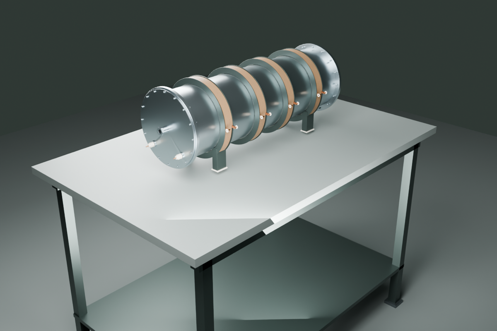
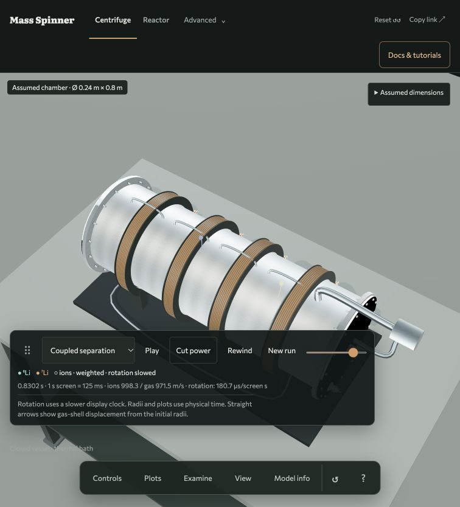

# Blender assembly improvements

The centrifuge now has a complete pressure shell and an illustrative laboratory station.
The editable scene is `blender/scenes/centrifuge-assembly.blend`.
The builder uses Blender 5.2.4 LTS.

## Geometry

| Previous problem | Cause | Change |
| --- | --- | --- |
| The wall could not close. | The exported mesh omitted part of its circumference. | Export a complete shell. Use the existing clipping plane to open it. |
| The lithium liner stayed open. | Its mesh covered only part of the circumference. | Use a complete liner with the same display clipping control. |
| Electrical leads crossed solid covers. | Their paths used an external endpoint without a cover opening. | Add cover bores and route each lead from the inner pin end. |
| Ceramic bodies overlapped copper pins. | The bodies were solid cylinders. | Use annular ceramic bodies with pin bores. |
| Parts lacked connection details. | Several surfaces used simple rings or blocks. | Add end covers, compression nuts, washers, creepage ribs, winding insulation, and aligned saddle fasteners. |
| The machine had no physical setting. | The scene contained only apparatus parts. | Add a workbench, support rails, legs, feet, and floor. |

Clipping a complete wall permits both closed and cutaway views from one asset.
Separate closed and cutaway models would duplicate the hardware and its part metadata.
The cover bores and annular insulators remove overlapping solids instead of hiding them with transparency.

## Runtime behavior

The importer places the station outside the scaled hardware group.
The table span follows vessel length.
Its width supports the apparatus bed.
The legs retain their height and cross section.

The camera frames the apparatus without the floor bounds.
The station cannot become a selected apparatus part.
It stays in place during part separation and the failure display.
Each imported station mesh owns its geometry and material.
Separate station transforms prevent vessel scaling from stretching the bench legs.
Excluding station bounds preserves camera framing without a fixed camera offset.

## Evidence and limits

Blender rendered the scene with Cycles.
The export contains nine hardware modules, one station group, and 316 meshes.
It contains no camera or baked animation.
The browser continues to calculate motion from simulation results.

Repeated rings use object transforms for their axial positions.
The existing lossless optimizer can then share identical meshes.
The application asset is 1,012,804 bytes.
The optimizer preserves all geometry streams and selectable nodes.
The Blender-to-GLB comparison preserves part metadata, material ownership, and bounds within one micrometre.

## Verification

| Check | Result |
| --- | --- |
| `node --import tsx --test --test-concurrency=1 tests/*.test.ts` | 1,699 passed; zero failures or skips |
| `npm run typecheck` | Passed |
| `npm run typecheck:infrastructure` | Passed |
| `npm run typecheck:boundaries` | Passed |
| `npm run typecheck:tests` | Passed |
| `npm run lint` | Passed |
| `npm run build` | Passed |
| `npm run check:site` | Passed |
| `npm run check:assets` | Passed |
| `npm run check:gltf` | Passed; zero glTF errors or warnings |
| `npm run release:seal` and `npm run release:verify` | Passed for the local build files |
| `python3 -m unittest discover -s blender -p 'test_compare_assembly.py' -v` | Two passed |
| `python3 blender/compare_assembly.py <optimized-glb> <blender-export>` | All 316 mesh nodes passed |
| `git diff --check` | Passed |

The browser check used the local production build at `http://127.0.0.1:4187/?level=2`.
It covered shell closure, cutaway changes, coil selection, part separation, reassembly, and playback.
It also covered a 390 × 844 phone viewport.
The browser reported no console errors.
The independent code review found no remaining concrete defect in the changed paths.

This version is not deployed to Cloudflare.
The local build retains the isolated guest's earlier Git identity.
Its manifest is not evidence of a release from the current working tree.
Publication requires a build from the committed source and the normal release checks.

These construction details are illustrative.
They are not measured Marathon dimensions, fabrication drawings, pressure qualification, or electrical certification.
The station is not a model of a Marathon facility.
This change does not improve experimental validation of the physics solver.

The broader factory-room work remains incomplete.
Walk-through navigation, utility equipment, and equivalent beam-source and power-reactor detail need separate changes.
